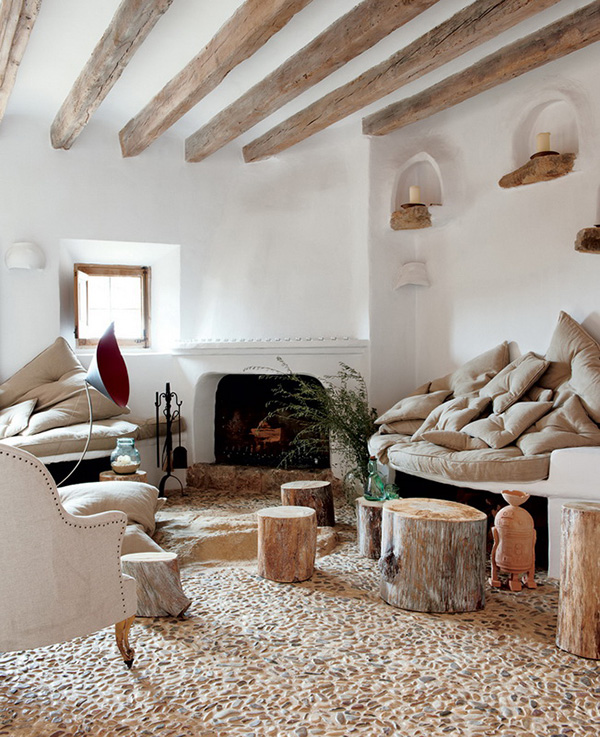

# NEDEN DOĞAL EV? – Sık Sorulan Sorular

**Tarih:** 31/05/2018  
**Orijinal Kaynak:** /sdmimproje/neden-dogal-ev-sik-sorulan-sorular.html  
**Arşiv Zaman Damgası:** 20190101105603  
**Etiketler:** Mimar Sinan, Doğal Yapı Rehberi, Çorlu & Trakya, Kırsal Mimari, Köy & Kaçış  
**Atlas Düğümleri:** medeniyet, dogal_yapi_rehberi, yerel_yonetimler, kirsal_koy  

---

Şehirden kaçıp doğal bir yaşam mı kurmak istiyorsunuz? Kırsalda yaşıyor ve ev, ahır, depo gibi yapıları betonla değil de doğal malzemeler mi inşa etmek istiyorsunuz? Kent merkezindeki eviniz betondan değil de topraktan mı olsun  istiyorsunuz? Doğal bir ev için ne yapmanız gerektiğini bilmiyor musunuz?

Soruların cevapları için: [https://www.sdmim.com/single-post/2018/05/28/DOGAL-EV-NEDEN](https://www.sdmim.com/single-post/2018/05/28/DOGAL-EV-NEDEN)

[www.sdmim.com](http://www.sdmim.com)

## SDMIM MİMARLIK | ARCHITECTURE

Şeyh Sinan Mah. Hülya Sk. No: 4 Amaç İş Hanı Kat: 3/24

Çorlu | Tekirdağ | Turkey

[sdmimmimarlik@gmail.com](mailto:sdmimmimarlik@gmail.com)

Tel: +90 (0) 282 654 1 413

Tel: +90 (0) 553 064 8 444
