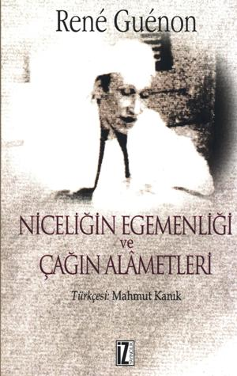

# Niceliğin Egemenliği ve Çağın Alametleri

**Tarih:** 11/03/2015  
**Orijinal Kaynak:** /sdmimproje/niceligin-egemenligi-ve-cagin-alametleri.html  
**Arşiv Zaman Damgası:** 20190419115333  
**Etiketler:** Datça & Ege, Doğu-Batı Ayrımı, İslam & Medeniyet Tasavvuru  
**Atlas Düğümleri:** kirsal_koy, dogu_bati, medeniyet  

---

René Guénon – Niceliğin Egemenliği ve Çağın Alametleri

**sdmimproje**
