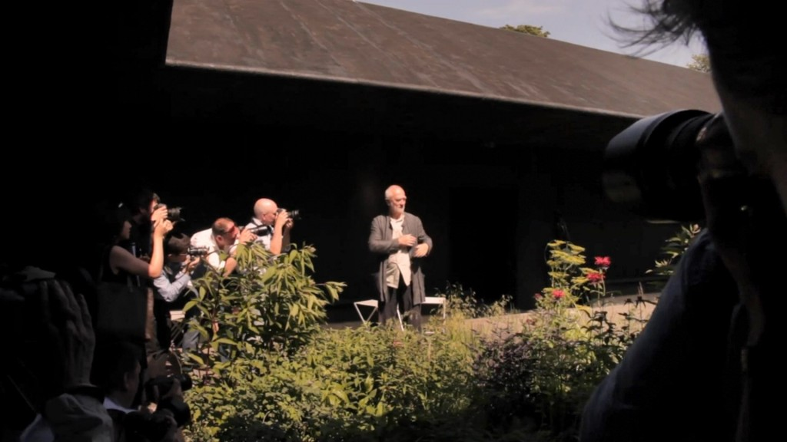

# Peter Zumthor Türkiye’de olsa bu görüntüyü ölmeden veremezdi

**Tarih:** 06/10/2012  
**Orijinal Kaynak:** http://sdmimproje.com/peter-zumthor-turkiyede-olsa-bu-goruntuyu-olmeden-veremezdi/  
**Arşiv Zaman Damgası:** 20190102090903  
**Etiketler:** Peter Zumthor, Doğu-Batı Ayrımı, İslam & Medeniyet Tasavvuru  
**Atlas Düğümleri:** mimarlik_egitimi, dogu_bati, medeniyet  

---

Peter Zumthor yeni tasarladığı bir yapının önünde gazetecilerin ısrarıyla poz veriyor. Bildiğiniz üzere, bu kadar gazeteci Türkiye’de ya siyasilerin ya da mankenlerin peşinde olur.

[peter zumthor](http://vimeo.com/50881965) from [sdmim](http://vimeo.com/user9386317) on [Vimeo](http://vimeo.com).

Ölmek önemlidir burada. Ölmeden pek konuşulmazsınız, hele de düşünür, sanatçı ya da mimarsanız filan ölmek genelde hatırlanmak için doğru bir deneyim olur.

**sdmimproje**