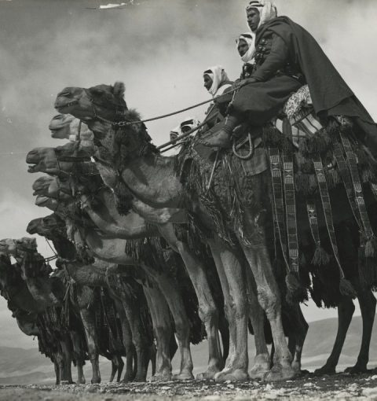

# Ricoldus De Monte Crucis 13. Yüzyılda Ne Dedi?

**Tarih:** 30/07/2018  
**Orijinal Kaynak:** /sdmimproje/ricoldus-de-monte-crucis-13-yuzyilda-ne-dedi.html  
**Arşiv Zaman Damgası:** 20190825021528  
**Etiketler:** Ricoldus de Monte Crucis, Datça & Ege, Fas & Mağrip, Mısır & Kahire, İslam & Medeniyet Tasavvuru, Doğu-Batı Ayrımı, Cami Mimarisi & Kubbe  
**Atlas Düğümleri:** dogu_bati, kirsal_koy, hassan_fathy, medeniyet  

---

Düzenleyen: Muhammed Ebrar Sağlam

Ricoldus De Monte Crucis 1243 yılında Floransa’da doğdu. Çeşitli üniversitelerde ilahiyat tahsil ettikten sonra 1267’de Dominikan Tarikatı’na girdi ve zamanın önemli eğitim merkezlerinden Santa Maria Novella Manastırı’nda ve Pisa Üniversitesi’nde hocalık yaptı. 1286 yılında Papa’nın emriyle Doğu Hıristiyan kiliseleri ve İlhanlı Sarayı nezdinde misyonerlik çalışmaları yapmak ve diplomatlık ilişkiler kurmak üzere Kutsal Topraklara seyahate çıktı.  Misyonerlik çalışması kapsamında Levant, Anadolu, İran ve Irak’ta bulunan Ricoldus, Moğol Hanı Argun’nun sarayına misafir oldu. 1290 yılında Bağdat’a giderek Nasturi Kilisesi’nin, Roma Kilisesi ile birleşmesi için girişimler başlattıysa da bunda başarılı olamadı. Bağdat’ta bulunduğu yıllarda Arapça öğrenerek, İslam teolojisi üzerine kapsamlı eserler vererek, oryantalizmin temellerini attı. 1300 yılında İtalya’ya dönerek, seyahatine dair gözlemelerini Papa’ya sunan keşiş, 1320 yılındaki vefatına dek tarikatı bünyesinde görevlerini sürdürdü.

Ricoldus De Monte Crucis, İslam’ın reddiyesine dair *Contra Legem Sarracenorum *(Müslümanların Yasasına Karşı) isimli tenkitnamesini kaleme almıştır. Bu eser sonraki yüzyıllarda *Confutation Alcorani *ismiyle basılmış ve birçok dile tercüme edilerek, İslam’ı tenkit eden Hıristiyan ilahiyatçılara kaynak olarak kullanılmıştır. Her ne kadar Müslüman inancına müsamahakâr bakmasa da, kendisinden önce İslam’ın reddiyesi üzerine yazan dindışı teologların düştükleri hataya düssşmeyerek, İslam’ın Kristolojik bir Heresi/ Sapkınlık değil apayrı bir din olduğu gerçeğini ortaya çıkarması bakımından Ricoldus’un yazıları ayrı bir önem taşımaktadır.

Her ne kadar üslubunda hadiselerden ahlaki ders çıkarma alışkanlığı ağır bassa da, seyahatnamesinin Moğolların yayılışı ve Avrupa’ya dek ilerleyişlerini, Bağdat ve Ortadoğu’daki diğer yerleşimleri fetihlerini anlatan bölümü modern tarih yazımını aratmayan bir tarafsızlık ve bilimsellik ihtiva etmektedir.

Ricoldus De Monte Crucis’in dürüst ve nispeten tarafsız bir dille kaleme alınan seyahatnamesi, *Contra Legem Sarracenorum *ve * Epistolae ad Ecclesiam Triumphantem *adlı eserleri ile bütün olarak ele alındığında, Ortadoğu’daki Latin varlığının sona erdiği, Moğol istilası sonrası bölgenin istikrara kavuşmaya başladığı ve o coğrafyaya sonraki yüzyıllarda hakim olacak aktörlerin ortaya çıktığı dönemin bir panoramasını çizmesi bakımından oldukça değerli bir eser.

Bunun yanı sıra, Müslüman dünyasına yönelik militarist perspektifin dışına çıkarak, sonraki 300 yıl Doğu-Batı dikotomisinin yönünün belirleyen bir kaynak ve oryantalizmin öncülü olması bakımından da mutlaka keşiş Ricoldus’un seyahatnamesi okunmayı, anlaşılmayı hak etmektedir. Aşağıda kitapta o dönemin Bağdat’ında Müslümanlar’ın yaşayışı hakkında yazdıkları bulunmaktadır.

> 
**Müslümanlar**

Bağdat şehri Müslümanların dini makamlar, mektepler ve mezhepler ile prensliklerine de ev sahipliği yapmaktadır. Şehirde eskiden Muhammed’in halefi olan ve Müslümanların Tanrı’nın yeryüzündeki yüzü dedikleri Halife hüküm sürdürüyordu. Yukarıda da anlattığımız gibi, Tatarlar Halife’yi öldürdüler. Büyük kısmı harabe haline gelmiş olsa da bu şehirde hala kalabalık bir nüfus yaşamaktadır. Nitekim şehirde iki yüz binden fazla Müslüman olduğu söylenmektedir ki, gördüğümüz kadarıyla bu inandırıcı bir sayıdır. Nüfusları binleri bulan Hıristiyanlar ve Yahudiler bu sayıya dahil değildir. Elbette bütün saydıklarımız Tatarların hakimiyeti altındadır. Bağdat Müslümanlar için önemli bir ilim merkezidir ve birçok büyük hoca burada ders vermektedir. Müslümanların büyük kısmı dindardır. Kendi içlerinde birçok mezhebe bölünmüşlerdir. Burada Müslümanlar megerrede dedikleri manastırlarında tahsil görürler. Onlarla Muhammed’in imansızlığını münazara etmek ve onları bundan kurtarmak üzere büyük bir istek duyuyor, onarlı kendi makamlarında, kendi okullarında yenmeyi amaçlıyorduk. Ancak bunu başarmak için bir süre onlarla beraber yaşamamız, söyleşmemiz gerekiyordu. Mekteplerinde, manastırlarında, kiliselerinde, sinagoglarında ve camilerinde bizi adeta Tanrı’nın gönderdiği meleklermişiz gibi karşılayıp buyur ettiler. Bize itikatlarını, kitaplarını anlattıklarında dikkatle dinledik ve böyle sapkın bir inançtan böyle faziletler ortaya çıkmış olmasına hayret ettik.

Bu fasılda, Müslümanları övmekten ziyade Hıristiyanları utandırmak amacıyla, kısaca Müslümanların bazı sihirli ve kusursuz faziletlerine, kerametlerine değineceğiz. Müslümanların ilimdeki titizlik ve heveslerini, ibadette mütedeyyinliklerini, yoksullara karşı merhametlerini, Allah’ın adına, peygamberlere ve kutsal yerlere hürmetlerini, davranışlarındaki ciddiyet ve ağırbaşlılığı, yabancılara nezaket ve saygılarını, kendi içlerinde birlik ve sevgilerini ve daha birçok faziletlerini gören hangi insan hayrete düşüp etkilenmez.

**Müslümanlarda İlim**

Müslümanlarda ilim ve tahsil kısaca anlatmaya yetmeyecek kadar önemlidir. Diğer bütün ülkelerden ve illerden Bağdat’a tahsil görmeye, ilim öğrenmeye gelirler. Bağdat’ta salt din adamlarının ilim öğrenmesi ve tefekküre dalması için kurulmuş, bizim büyük manastırlarımıza benzer yapılar inşa etmişlerdir. Buraya gelenler, müştereken yaşarlar, barınma, ekmek ve su gibi ihtiyaçlarını cemiyet karşılar. Talebeler ise kendi istekleriyle büyük bir fakirlik içinde yaşayarak, kendilerini ilim ve tefekküre verirler. Mekteplerinde topluca Kuran öğretilir, ancak okuldan içeri çıplak ayakla girmek zaruridir. Bunlardan bir tanesine gittiğimizde, ders veren hocalar ve dersi dinlemeye gelen talebeler ayakkabılarını dışarıda bıraktılar ve mektebe çıplak ayakla girdiler.

**Müslümanların İbadetleri**

Müslümanların ibadetleri hususunda ne denebilir? Müslümanlar ibadetlerinde o kadar titiz ve sofudurlar ki dindar bir Hıristiyan olarak bizzat tecrübe edip, gördüklerimden ve yaşadıklarımdan büyük bir şaşkınlığa düştüm. Zira üç buçuk ay boyunca Müslümanların kervanında, deve üzerinde Arap çölü ve İran’da yolculuk ederken, deve kervanındaki Arapların istinasız hepsi günün ve gecenin belirli saatlerinde, sabah erkenden ve akşam namaz kılıyorlardı. İbadetleri sırasında dindarlıkları o kadar derindi ki namaz kılarken yaptıkları tüm işleri bir kenara bırakıyorlardı. Dua ettikleri sırada suratları renk değiştirip, kül gibi soluyor, vecde gelmiş gibi görünüyorlardı. Kimisi yere düşüyor, kimisi zıplıyordu, sesleri değişiyor ve başları öne devriliyordu. Bazıları cezbeye kapılmış gibi kendinden geçiyor, bazılarıysa cin çarpmış gibi hareketler sergiliyordu. İbadetleri sırasında bedenlerinin temizliğine azami ihtimam gösteriyorlardı. Önceden kaba etlerini, karınlarını, ellerini, yüzlerini ve ayak tabanlarını yıkamadan kati suretle namaz kılmıyorlardı. Böylece ibadet etmeye geçiyorlardı. Bu, hangi mezhep olursa olsun tüm Müslümanların ifa ettiği bir alışkanlık. Tüm Müslümanlar arasında en kusursuz kabul edilen mezhep Hanefa dedikleri mezheptir. Pazar yerine çıktıklarında kediye, köpeğe, eşeğe veya kirli eşyalara insanlara dokunmazlar. Eğer bin beş yüz kova su olmazsa, abdest alamazlar ve namaz kılamazlar. Bu yüzden nehir gerekir. Eğer namaz kılmak isterlerse, nehre çırılçıplak girerler ve bütün vücutlarını yıkarlar. İyice yıkandıklarına kanaat getirdiklerinde, parmaklarıyla anüslerini yoklarlar ve bu burunlarına götürüp, kötü koku olup olmadığını koklayarak kontrol ederler. Eğer temizlikleri ibadet edebilmeye müsait değilse nehre geri dönerler. Eğer kötü koku gelmiyorsa temizlikleri ibadet etmek için münasiptir demektir.

**Müslümanlarda Sadaka ve Yoksullara Merhamet**

Yoksullara merhamette, sadaka vermede Müslümanlardan daha eli açık hiç kimseyi görmedik. Kuran’da herkesin sahip olduğu malın onda birini sadaka olarak vermesine dair hüküm bulunur. Savaşta ganimet olarak elde ettiklerinin ise beşte birini verirler. Savaştan önce buna dair yemin ederler ve ganimetleri ele geçirdiklerinde tüm bu parayı, malı ve mülkü devlet hazinesine koyarlar. Zamanı gelip, ihtiyaç hasıl olduğunda hazine açılır ve başka ülkelere giden, itimat duyulan bir Müslüman’a verilir. O kişi bu paralarla Hıristiyanların ve diğer milletlerin elinde esir tutulan, köle edilen Müslümanların fidyelerini öder ve serbest bırakır. Kimi zaman bazı Müslümanlar, diğer Müslümanlardan  ellerindeki esir Hıristiyan köleleri de satın alıp, onları mezarlığa götürür ve “*Annemin ve babamın ruhu hayrına seni azat ediyorum,”* derler ve ellerine bir azat belgesi verip serbest bırakırlar.  Köle azat edemeyecek kadar fakir olanlar için, kuş yakalayan ve kafese kapatan başka Müslümanlar vardır. Bunlar sokak sokak gezerler ve “*Kim bu kuşları satın alıp, ölmüşlerinin ruhuna için azat etmek ister?” *diye çığırırlar. Yoksullar bu kuşlardan satın alırlar ve ölmüşlerinin ruhu için azat ederler.

Ayrıca hayırsever kişiler ruhlarının mahpus kalmaması için, vasiyetlerinde sokaktaki köpeklerin Allah rızası beslenme için para bırakırlar. Türkiye’de, İrlanda’da ve Bağdat’ta sokaklarda çokça köpek görmek mümkündür. Bu ülkelerde, köpeklerin insanlardan onlar için miraslarında pay bırakmalarını isteyen hamileri olduğunu gördük. Eğer köpeklerin bakımı için miras bırakılan para yetmezse şehirdekilerden sadaka toplarlar ve köpekler arasında pay ederler. Ayrıca nehirdeki kuşların beslenmesi için sadaka olarak bolca ekmek verirler. Öyle ki nehirdeki kuşlar da buna alışmıştır ve her gün belirli saatlerde, belirli bir sesi duyunca toplaşırlar. Böylece toplanan kuşlara sadakalar dağıtılır. Buna en çok yüce Bağdat ve Ninova şehirlerinde rastlanır.

Havanın çok sıcak olduğu Bağdat şehrinde birçok meczup ve deli bulunur. Şehrin yakınlarında bu delilerin topluca bakımı, yedirilip içirilmesi,  usta hekimler elinde tedavi görmeleri için güzel hastaneler yapmışlardır. Bütün masrafları şehir sakinlerince müşterek karşılanır.

**Müslümanların Tanrı’nın Adına Hürmetleri**

Müslümanların, Tanrı’nın adına, peygambere, ermişlere ve kutsal yerlere gösterdikleri hürmet muazzamdır. Gerçekten de bunlara çok dikkat ederler ve başında Tanrı’nın adını anmadan önemli hiçbir şey yapmazlar, söylemezler veya yazmazlar. Birbirlerine gönderdikleri mektuplara daima Tanrı’nın adını yazıp, överek başlarlar. Bu yüzden yazıyı yırtmamaya ve yere atmamaya dikkat ederler. Eğer yolda yürürken yerde yazılı bir kağıt bulurlarsa Tanrı’nın adının yazılı olduğu kağıdı, ayaklar altında kalmamaıs için hürmetle kaldırırlar ve yerden yüksek bir duvara koyarlar. Konuşup, karşındakini dinlerken konuşmada Tanrı’nın adı geçerse, asla tek başına telaffuz etmezler ve belli bir övgü sözüyle birlikte anar, “*Deus laudetur ipse” *ve benzeri övgü sözlerini sarf ederler. Ve eğer bir Müslüman küfür ederken Tanrı’nın veya peygamberin adını anarsa o kişiyi kati surette yaşatmazlar, acımadan öldürürler. Kutsal yerlerini, mescitlerini daima temiz tutarlar. Ayaklarında ayakkabı ile asla içeri girmezler. İçeride kesinlikle tükürmezler. Mescitlerinde otururken, kaba etlerinin mescidin zeminine temas etmemesine dikkat ederler ve topuklarının üzerine otururlar. Ailelerimizin bize uyuşmasınlar diye bacaklarımız çapraz oturmayı öğrettiği gibi, gençlerine çocukluktan itibaren böyle topuklarının üzerine oturmayı öğretip alıştırırlar ki ilerde mescitte uzun süre otururken yorulmasınlar.

**Müslümanlarda Ağırbaşlılık**

Müslümanlar hareketlerinde o kadar ciddi ve ağırbaşlıdırlar ki, kimse başı, gözleri, boynu dik, göğsü ilerde,  kolları sallanarak yürüyen bir Müslüman göremez. Sokakta yürürken, küçük çocuklar bile olgun, dindar, mütevazı, ahlaklı biri edasıyla yürür. Uzun yıllar İran ve Bağdat’ta tanışıp sohbet ettiklerimden, nafile şarkılar söyleyen hiç kimseyi hatırlamıyorum. Ama tam tersine daima Tanrı’yı, dinlerini ve Peygamberlerini yüceltmek ve övmek için şarkılar söylerler. Mescitlerde ve başka yerde şakalaşmazlar, birbirleriyle alay etmezler, başkasının arkasından kötü konuşmazlar ve çekiştirmezler.

**Yabancılara Nezaket ve Saygı**

Müslümanlar yabancılara karşı ziyadesiyle nazik ve saygılıdırlar. Öyle ki misafirlerini sanki melekmiş gibi karşılarlar. Asilzade ve bilge kişilerin evlerine misafir gittiğimizde, bizleri öyle bir sevinçle ve hevesle karşıladılar ki böyle bir misafirperverliği ancak kendi tarikatımızın evlerinde görebildik. Bizden dostça ve kibarca Tanrı’dan, İsa’dan bahsetmemizi rica ediyorlardı. Ve bizim yanımızda İsa’dan bahsederken, onun Tanrı’nın Oğlu değil, dürüst bir insan ve büyük bir peygamber olduğunu söylüyor, ancak adını daima çok büyük bir saygı ve hürmetle anıyorlar,  “*Christus laudetur ipse” *veya benzeri bir şekilde hitap ediyorlardı.

Onları en fazla rahatsız eden şey, onlarla birlikte yemek yemeyişimizdi. Çünkü Müslümanların âdetinde, bir yabancı ziyarete geldiğinde, misafire daima yemek ikram edilir. Bu âdet Müslümanlar içinde en asilleri olan Araplar arasında yaygındı. İtimat edip davete icabet ederek kendileriyle beraber aynı sofraya oturup yemek yiyen birine asla fenalık yapmazlardı. Kendileriyle beraber tuz ve ekmek yiyen birine kardeş derler ve bundan böyle misafir, babasını bile öldürse başka kişilere karşı korur, müdafaa ederdi.

**Müslümanlar Arasında İttihat ve Sevgi**

Müslümanlar arasındaki ittihat ve karşılıklı sevgi öyle büyüktür ki, birbirlerini kardeş olarak görürler. Birbirleriyle bilhassa da yabancılarla konuşurken “*O fili matris mee*” diye hitap ederler. Birbirlerini öldürmez ve soymazlar. Bir Müslüman, diğer yabancı Müslüman ve barbar milletlerin topraklarından geçerken emin ve güvendedir. Bir keresinde Babil sultanı, vekili ve eyalet valisini eyaletin vergisini teslim alması için Mısır’dan Suriye’ye bir ordunun başında göndermişti. Vali ve onunla beraber tüm eyalet, efendileri sultana karşı ayaklandı. Buna kızan sultan isyancıların üzerine büyük bir ordu gönderdi. Hain komutan da eyaletten büyük bir ordu topladı. İki ordu da karşılıklı karargâh kurmuş, muharebeyi beklerken birbirlerine, “*Hepimiz Müslüman değil miyiz? Birbimizle harp edip öldürmemiz caiz değildir. Sadece efendisine başkaldıranı öldürelim ve hepimiz barış içinde yaşayalım *” dediler. Böylece iki büyük ordunun birbirine girip boğazlaşmasındansa sulh yapıldı, huzur tesis edildi.

Dininde katliam ve ölüm olanlara bir bakın, birbirlerini öldürmek istemiyorlar. Dinlerinde hayat olan, dinleri barış ve sevgiyi emreden zavallı Hıristiyanlar ise acımasızca birbirlerini katlediyor. Ama eğer bir Müslüman başka bir Müslüman’ı belli bir sebeple veya salt kötülükten dolayı öldürürse ölenin oğlu veya kardeşi nadiren intikam gözetir. Ortak dostları toplanır ve katille görüşerek, ölenin oğlu veya kardeşine götürerek rehin alırlar. Rehin alınan katili mezarlığa götürür ve “*Öldürdüğün babanın oğluyum ben. Eğer ben de seni öldürürsem bunun ona bir hayrı dokunmayacak,*” derv e ekler, “*Eğer bir Müslüman’I öldürmek fenaysa ikisinin öldürülmesi daha fenadır.*” Daha sonar “*iceun lelle*” derler ve katil saçalrını keserek onları selametle uğurlar. O halde her gün “*Dimitte nobis debita nostra sicut et nos dimittimus etc.*” diyen Hıristiyanların mazereti nedir ki Müslümanlar kabahatlerin affedilmesinde onlara bu kadar üstün olsun?

Müslümanlar öldürmmekten o kadar tiksinirler ki ne tavuk öldürebilirler ne pire. Canları tavuk yemek istediğinde, tavuğu ellerine alıp sokağa çıkarlar ve oradan geçen birinden, kendisi için öldürmesini rica ederler. Müslümanlar böyle yaparlar fakat dinlerinde öldürmek vardır. Bu sayede inananların yürekleri katılaşır, kendilerini her türlü tehlikeye korkmadan atarlar, bu sayede canla başla savaşırlar. Dinleri onları sertleştirdiği için muhaberede inançal birbirlerine yardım ederler. Dinleri yüreklerini hep katılaştıracağından, erdem ve zaferleri de kılıçla sürer. Dinlerinin gerçekten şiddet dolu olduğunu bilahare gösterceğiz. Bir zamanlar Müslümanlar ve Hıristiyanlar arasında cereyan eden bir savaşta, Monchor adında bir Müslüman varmış. Kendisinden daha yüksek mertebede soylu bir Müslüman’ın atından düşerek, ölüm veya Hıristiyanlara esir düşme tehlikesiyle karşı karşıya kaldığını görmüş.  Derhal kendi atından inmiş ve “Benim atıma bin ve kaç. Çünkü senin esir düşmen veya ölmen benim çlmem  veya esir düşmemden daha fenadır,” demiş. Öteki Müslüman dediğini yapmış ve kaçmış. Atını veren ise ötekinin yerine esir düşmüş. Gel zaman git zaman, onun atıyla kaçan soylu sultan olmuş ve onu zinadan kurtarıp, esir tutan Ermenistan krallığındaki Hıristiyanlardan öcünü almış. Günahın çocukları arasındaki ittihat ve birlik böyle. Müslümanlar, Hıristiyanlara “*Erubusce Sidon, ait mare*!” deseler yeridir.

Not: Yukarıda anlatılanlar, lanetlenmiş Müslümanların uğruna ellerinden geleni ardına koymadıkları ölüm dini Müslümanlığa bir övgü değil, hayat veren dinleri için kıllarını kıpırdatmayan Hıristiyanları utandırmak içindir.

**Doğu Seyahatnamesi – Bir Dominikan Keşişin Anadolu ve Ortadoğu Yolculuğu – Ricoldus de Monte Crucis**