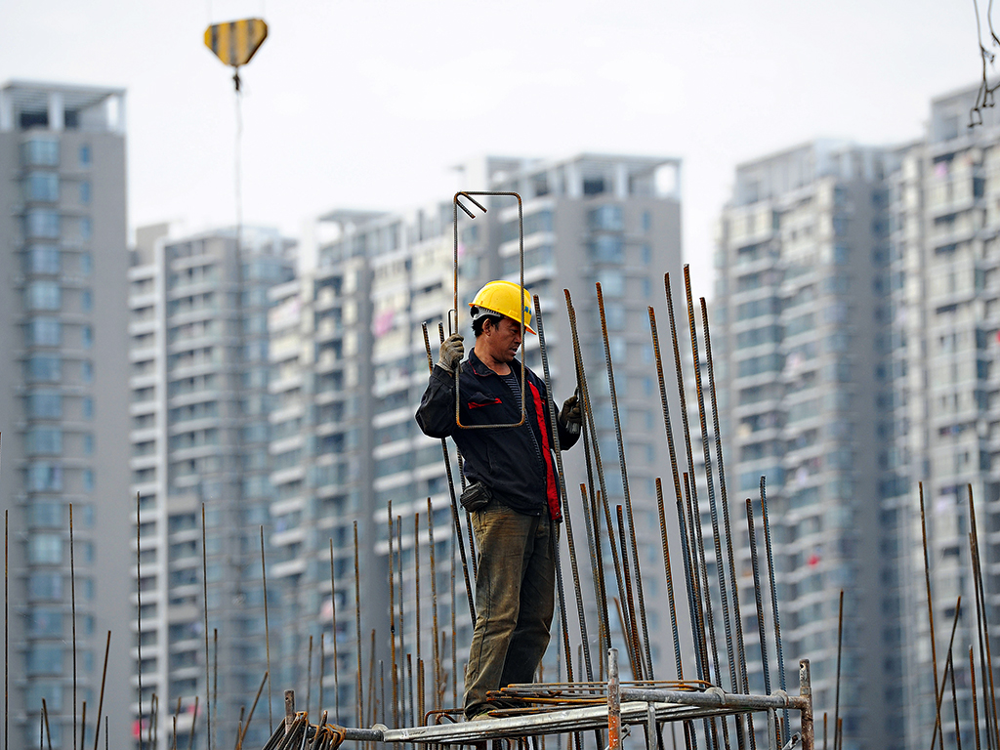
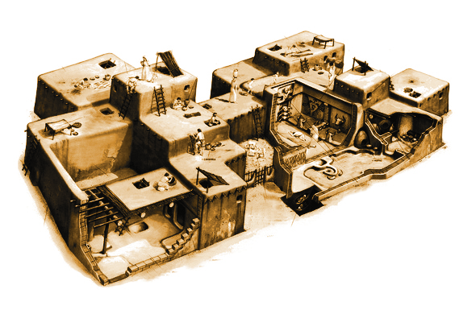
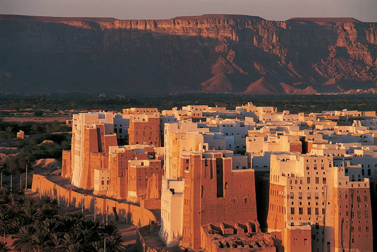
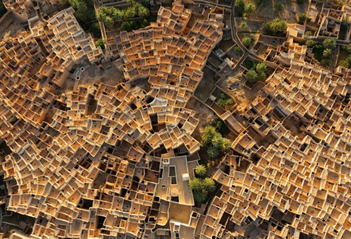
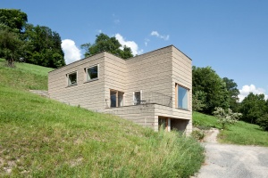
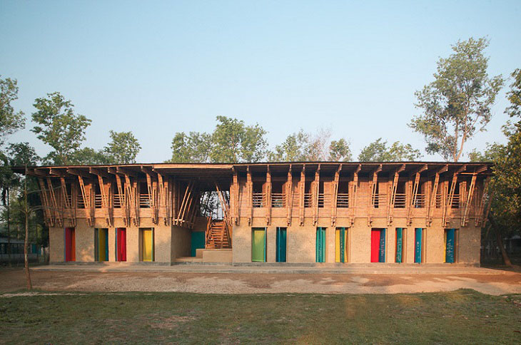
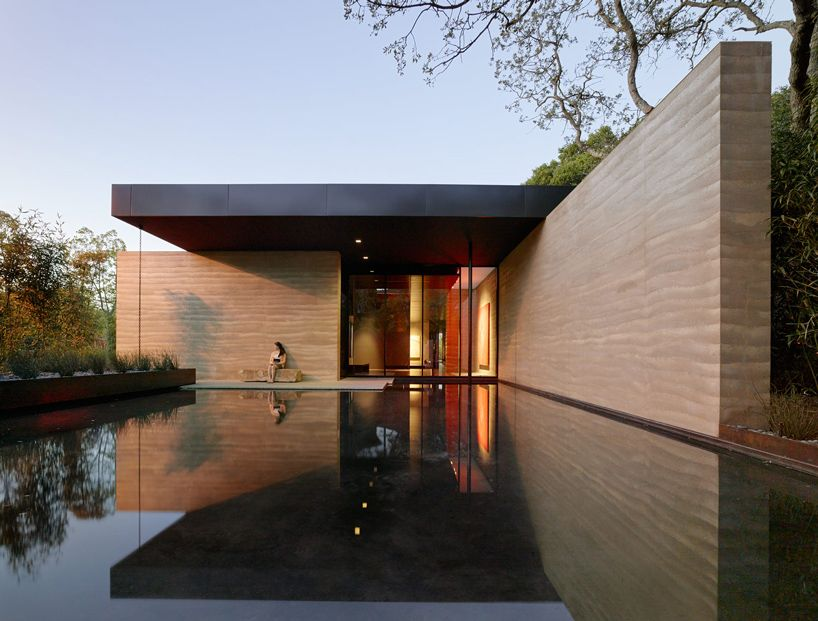
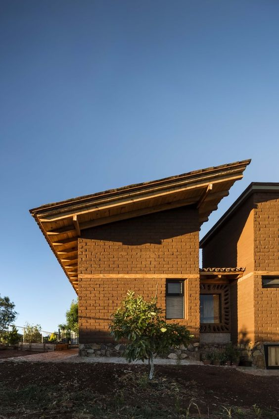
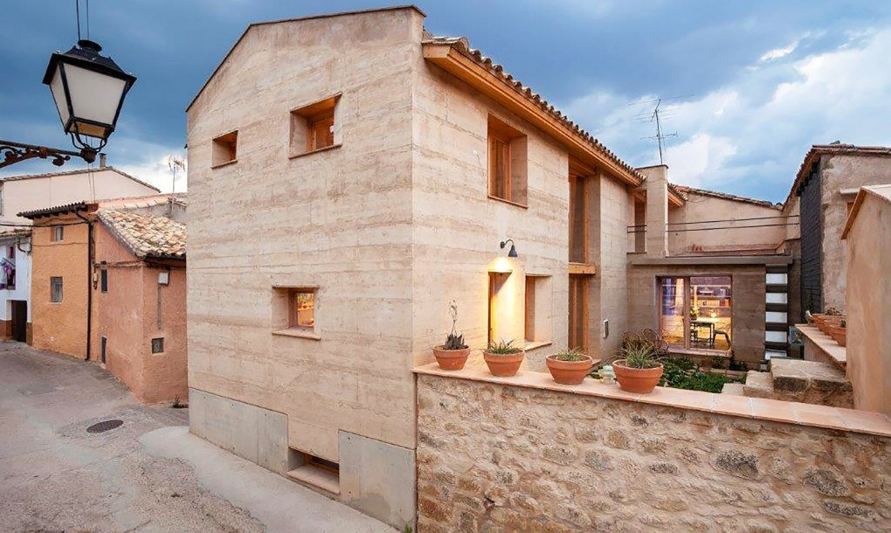

# SADIK YARİM KARA TOPRAK

**Tarih:** 16/07/2018  
**Orijinal Kaynak:** http://sdmimproje.com/sadik-yarim-kara-toprak/  
**Arşiv Zaman Damgası:** 20190825024731  
**Etiketler:** Toprak Yapı, Pasif İklimlendirme, Doğal Yapı Rehberi, Auroville (Hindistan), Meksika, Apartman & Dikey Şehirleşme Eleştirisi, Kapitalizm & Çevre  
**Atlas Düğümleri:** toprak_yapi, pasif_iklim, dogal_yapi_rehberi, auroville_ornegi, dogu_bati, apartman_elestirisi, kapitalizm_mulkiyet  

---

# [Alternatif Bir Yapı Malzemesi Olarak Toprak](http://www.arkitera.com/gorus/1185/alternatif-bir-yapi-malzemesi-olarak-toprak)

## Toprak hala en sağlıklı ve en iyi ısı yalıtım malzemesi olma özelliğini koruyor. Üstelik nefes aldığından ortamın nemini dengeliyor. Bir toprak yapının inşası tamamen lokal malzemelerle yapıldığından oldukça da ekonomik.

Betonla inşaat

Çok teknikmiş gibi duran bu başlığın altında yazılacak olanlar sadece inşaat sektöründe olanları değil, nefes alan herkesi ilgilendiriyor. Evet nefes alan… İnsanlar, hayvanlar, bitkiler, kısacası yaşayan herkesi. Bu sözlerle ilgini çekmiş olmalıyım nitekim yazının girişi, haber sitelerinde örneğin “cep telefonu olanlar dikkat” ya da “banka hesabı olanlar mutlaka okusun” gibi zaten herkesin sahip olduğu nesneler üzerinden, sadece okuyan kişiyi ilgilendiriyormuşçasına yapılan haberler gibi oldu. Fakat şimdi anlatacaklarımı okuduktan sonra bana hak vereceğini düşünüyorum.

Çatalhöyük toprak evler

Markete gidip aldığımız çikolatanın bir gıda ürünü olduğunu hepimiz biliyoruz. Bu ürün birtakım işlemlerden geçirilip ambalaja konulup satışa çıkartılmış. Bunu aklımızda tutalım. Şimdi bir topluluğa aydınlatıcı bir konuşma yapan birini gözlerimizin önüne getirelim. Mesela bu kişi TED’de konuşuyor olsun. Sahnenin altından güzel bir açıyla çekilmiş fotoğrafında konuşmacı, ellerinde seyirciye gösterdiği iki şeyi tutuyor. Bunlardan biri meşhur bir markanın çikolatası iken diğeri bir elma. Fotoğraf ilgimizi çekiyor, tıklayıp videoyu açıyoruz. Bu kişinin çikolata ve elma ile ne anlatmak istediğini hemen öğrenmek istediğimizden videoyu o ana getiriyoruz. Konuşmacı diyor ki: “Bu çikolatayı bir şirket fabrikada üreterek paketledi ve satışa sundu, bu elmayı ise doğa kabuğunun içinde bize verdi.” Konuşmacı bize elmanın da bir ürün olarak değerlendirilebileceğini anlatmaya çalışıyormuş meğer. Aynı konuşmacı muhtemelen bu iki ürünün hem vücudumuzla hem de ambalajlarının doğayla olan uyumundan da bahsediyor olmalı. Çikolatanın içindeki rafine şeker ile elmadaki meyve şekerinin farklarından, çikolatanın paketinin doğada çözünmediğinden, oysa elmanın kabuğunun hem yenilebildiğinden hem de doğaya geri karıştığından…

Yemen ‘Çölün Gökdelenleri’ yüzyıllardır ayakta

Libya’da toprak bir yerleşim

Yapı malzemesi mevzusuna dönecek olursak, tıpkı çikolata ve elma durumunda olduğu gibi, ürettiğimiz yapılar da doğa ile uyumlu değil. Bu yapılar daha inşa edilmeye başlanmadan, binaları ortaya çıkaracak malzemelerin üretim aşaması bile çevreye oldukça zararlı. Üstelik çikolata gibi yenmediğinden olsa gerek üreticiler sağlığa zararlı maddeleri yapı malzemelerine doldurmaktan çekinmiyorlar. Biz insanlar her geçen gün yaşamak için yeni yapılar üretirken, ekosistemin alanını biraz daha daraltıyoruz.

Avusturya’da bir toprak ev

“Ülkemizde inşa çalışmaları için en çok kullanılan yapı malzemesi hangisidir?”, diye sorsam, sanırım “beton” cevabını almakta zorlanmam. Bu cevabı ev hanımları, çocuklar, CEO’lar, otobüs şoförleri, öğrenciler velhasıl herkesten rahatlıkla duyabiliriz diye düşünüyorum. Verilere bakacak olursak, Avrupa Hazır Beton Birliği (ERMCO) raporuna göre, 2011 yılına ABD’yi yakalayan Türkiye, bugün ise dünyada Çin ve Hindistan’dan sonra en çok çimento kullanan ülke konumunda. ABD’nin nüfusunun 300 milyonun üstünde olduğunu hatırlatmama gerek yok sanırım.

Kısacası yeri göğü betonlaştırıyoruz. Çimento üretilirken, taşınırken ve beton olarak kullanıldıktan sonra bile çevreye zararlı. Görsel zararından bahsetmiyorum bile.

Peki ne yapılabilir. Doğaya uyumlu ve dönüşebilen yapılar yapmak mümkün mü? Elbette mümkün. Dışarıya çıktığında (eğer bulabilirsen) toprağın üzerinde yürü. Evet işte o üzerine bastığın topraktan yapılar üretip içinde oturabilirsin.

Bangladeş’te okul

Yeni bir şeyden bahsetmiyorum aslında. İnsanlık tarihinde toprak ile üretim M.Ö. 9000 yıllarına kadar gidiyor. Anadolu’da da M.Ö. 8000 yıllarında Aşıklı Höyük ve M.Ö. 7500 yıllarında Çatalhöyük yerleşimleri ilk toprak yapıların görüldüğü yerler. M.Ö. 1300 yılında inşa edilmiş II. Ramses’in tonoz çatılı toprak tahıl depoları hala ayakta.

Toprak hala en sağlıklı ve en iyi ısı yalıtım malzemesi olma özelliğini koruyor. Üstelik nefes aldığından ortamın nemini dengeliyor. Bir toprak yapı inşası tamamen lokal malzemelerle yapıldığından oldukça ekonomik. Üstelik beton ile üretilen konutlar gibi, nükleer santral mi yoksa ev mi inşa ediliyor karmaşasını yaşatmıyor.

ABD’de topraktan inşa edilmiş bir kamu binası

Bugün uzmanlar tarafından, geleneksel yöntemlerle modern teknikler birleştirilerek toprak yapılar yapılıyor. Özellikle gelişmiş ülkeler bu tekniklerin araştırılması ve uygulanması için büyük çaba harcıyorlar. Bizler ise toprak mimarlığının ana vatanında olmamıza rağmen unuttuğumuz geleneksel teknikleri yeniden hayata döndürmek için bile hala emekleme durumundayız.

Mars’a gitmek iyi hoş peki, ama doğa ile uyumlu malzemelerden yapılar inşa etmek ve hala üzerinde yaşadığımız dünyayı kirletmeyen, sürdürülebilir ve sağlıklı yapılar inşa etmek de önemli bir inovasyon olsa gerek ne dersin?

 

Doğal Yapı İnşaatları İçin: [SDMIM MİMARLIK | ARCHITECTURE](http://www.sdmim.com)