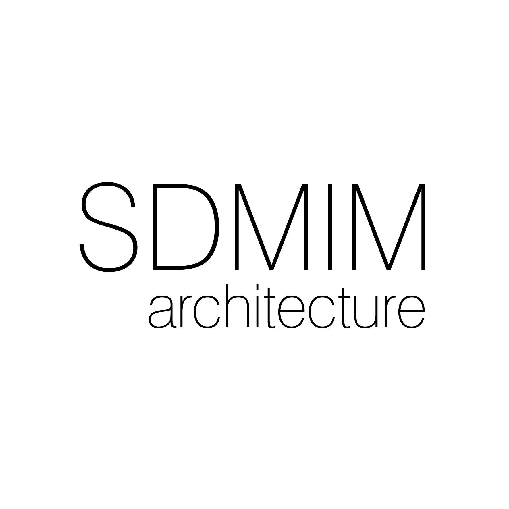

# SDMIM Mimarlık | Architecture Çorlu – Tekirdağ – Turkey

**Tarih:** 03/01/2018  
**Orijinal Kaynak:** /sdmimproje/sdmim-mimarlik-architecture-corlu-tekirdag-turkey.html  
**Arşiv Zaman Damgası:** 20190101131024  
**Etiketler:** Mimar Sinan, Doğal Yapı Rehberi, Çorlu & Trakya, Fas & Mağrip, Kırsal Mimari, Köy & Kaçış  
**Atlas Düğümleri:** medeniyet, dogal_yapi_rehberi, yerel_yonetimler, dogu_bati, kirsal_koy  

---

[SDMIM Mimarlık](http://www.sdmim.com), Tekirdağ, Çorlu’da** Mimari Proje**,** İç Dekorasyon** ve **Doğal Yap**ı hizmeti vermektedir.

SDMIM Mimarlık Resmi Sayfası: [www.sdmim.com](http://www.sdmim.com)

## SDMIM MİMARLIK | ARCHITECTURE

Şeyh Sinan Mah. Hülya Sk. No: 4 Amaç İş Hanı Kat: 3/24

Çorlu | Tekirdağ | Turkey

[sdmimmimarlik@gmail.com](mailto:sdmimmimarlik@gmail.com)

Tel: +90 (0) 282 654 1 413

Tel: +90 (0) 553 064 8 444

[www.sdmim.com](http://www.sdmim.com)

Tekirdağ, Çorlu, Çerkezköy, Saray, Ergene, Kapaklı, Marmaraereğlisi, Silivri, Hayrabolu, Süleymanpaşa, Şarköy, Muratlı, Kırklareli, Edirne

Konut Projesi, Site Projesi, AVM Projesi, Doğal Yapılar, Doğal Yapı Projesi, İç Dekorasyon, Otel, Hastane Projesi, Restoran Projesi, İç Mimar, İç Mimarlık, Stand Tasarımı, Ofis Dekorasyonu, Ofis Binası Projesi, Mimari Proje, Lüks Konut Projesi
