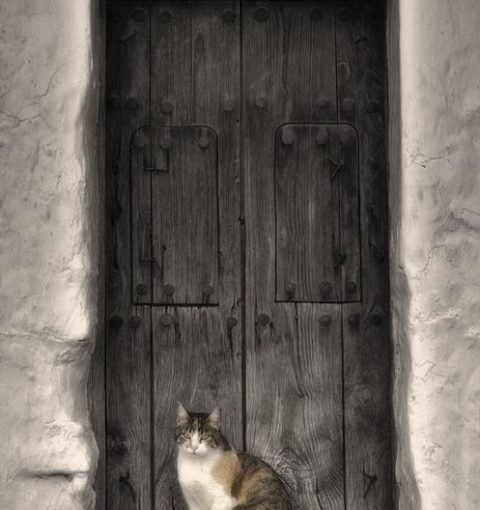

# SDMIM Mimarlık | Architecture DOĞAL YAPILAR

**Tarih:** 03/01/2018  
**Orijinal Kaynak:** http://sdmimproje.com/sdmim-mimarlik-architecture-dogal-yapilar/  
**Arşiv Zaman Damgası:** 20190101065902  
**Etiketler:** Mimar Sinan, Kerpiç, Geleneksel Ahşap & Hımış, Doğal Yapı Rehberi, Çorlu & Trakya, Fas & Mağrip  
**Atlas Düğümleri:** medeniyet, toprak_yapi, geleneksel_ahsap, dogal_yapi_rehberi, yerel_yonetimler, dogu_bati  

---

[SDMIM Mimarlık](http://www.sdmim.com), doğal yapı hizmeti vermektedir.

SDMIM Mimarlık Resmi Sayfası: [www.sdmim.com](http://www.sdmim.com)

## SDMIM MİMARLIK | ARCHITECTURE

Şeyh Sinan Mah. Hülya Sk. No: 4 Amaç İş Hanı Kat: 3/24

Çorlu | Tekirdağ | Turkey

[sdmimmimarlik@gmail.com](mailto:sdmimmimarlik@gmail.com)

Tel: +90 (0) 282 654 1 413

Tel: +90 (0) 553 064 8 444

[www.sdmim.com](http://www.sdmim.com)

Tüm Türkiye’ye hizmet verilmektedir.

Mimarlık’ta Doğal Yapı Kullanımı – Doğal Yapılarla İnşa: Toprak (Kerpiç), Ahşap, Taş
