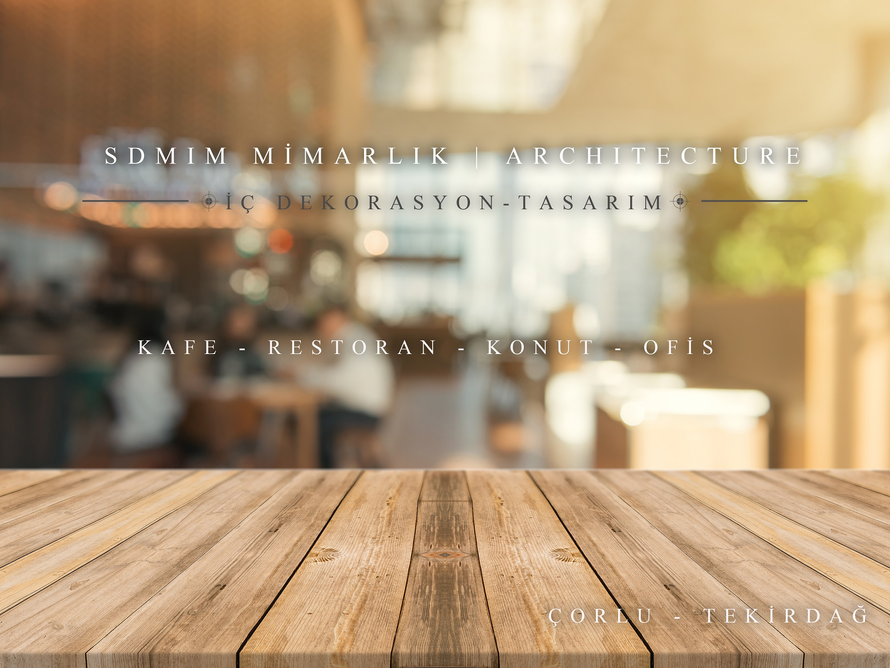

# SDMIM Mimarlık – İç Dekorasyon, Çorlu

**Tarih:** 03/01/2018  
**Orijinal Kaynak:** /sdmimproje/sdmim-mimarlik-ic-dekorasyon-corlu.html  
**Arşiv Zaman Damgası:** 20190101170328  
**Etiketler:** Mimar Sinan, İstanbul, Çorlu & Trakya, Fas & Mağrip, Kırsal Mimari, Köy & Kaçış  
**Atlas Düğümleri:** medeniyet, sehir_hukuku, yerel_yonetimler, dogu_bati, kirsal_koy  

---

[SDMIM Mimarlık](http://www.sdmim.com), Tekirdağ, Çorlu’da **iç mimari** tasarımı ve **dekorasyon** hizmeti vermektedir.

SDMIM Mimarlık Resmi Sayfası: [www.sdmim.com](http://www.sdmim.com)

İç Mimarlık Hizmetleri. SDMIM Mimarlık

Kafe Dekorasyon. Ofis Dekorasyon. Ev Dekorasyon. Mağaza Dekorasyon. Otel Dekorasyon. Villa Dekorasyon. Kreş Dekorasyon. Okul Dekorasyon. Hastane Dekorasyon. Tadilat.

## SDMIM MİMARLIK | ARCHITECTURE

Şeyh Sinan Mah. Hülya Sk. No: 4 Amaç İş Hanı Kat: 3/24

Çorlu | Tekirdağ | Turkey

[sdmimmimarlik@gmail.com](mailto:sdmimmimarlik@gmail.com)

Tel: +90 (0) 282 654 1 413

Tel: +90 (0) 553 064 8 444

[www.sdmim.com](http://www.sdmim.com)

Konut, Ofis, Otel, Restoran, Kafe, Fabrika, Ev, Mağaza Dkorasyon, İç Mimari Tasarım.

Tekirdağ, Çorlu, Kırklareli, Edirne, İstanbul, Çerkezköy, Marmaraereğlisi, Saray, Hayrabolu, Şarköy, Ergene, Süleymanpaşa, Kapaklı, Malkara, Silivri, Keşan, Babaeski, Demirköy, Lüleburgaz