# sdmim proje’den T.C. Çevre Ve Şehircilik Bakanlığı’na açık mektup

**Tarih:** 2012-10-15T12:12:14+00:00  
**Orijinal Kaynak:** /sdmimproje/sdmim-projeden-t-c-cevre-ve-sehircilik-bakanligina-acik-mektup.html  
**Arşiv Zaman Damgası:** 20121231205806  
**Etiketler:** Turgut Cansever, Geleneksel Ahşap & Hımış, Depreme Dayanıklı Yapı, İstanbul, Fıtrî Mesken & Ev Felsefesi, Müstakil Yaşam & Hürriyet, Şehir Hukuku & Şehircilik, Apartman & Dikey Şehirleşme Eleştirisi, Kapitalizm & Çevre, Kırsal Mimari, Köy & Kaçış, Mimarlık Ortamı & Akademi Tenkidi  
**Atlas Düğümleri:** cansever, geleneksel_ahsap, afet_deprem, sehir_hukuku, ev_felsefesi, mustakil_yasam, apartman_elestirisi, kapitalizm_mulkiyet, kirsal_koy, mimarlik_egitimi  

---

Bu mektup, 20 sene sonra “bizi o günlerde herhangi bir mimar ya da mimari grup uyarmadı veya alternatif bir yol önermedi”  denmemesi için kaleme alınmıştır. Öncelikle Türkiye’nin mevcut inşai üretiminden bahsedilecek ardındansa üzerine çokça düşünülmüş yeni bir alternatif konut üretim sistemi önerisi yapılacaktır.

** 1.**  **Türkiyenin Mevcut İnşaat Üretimi Üzerine**

Türkiye’nin hızlı kentleşmesinin sonuçlarından biri olan çarpık kentleşme, çarpık modernizm algısıyla birleşince, düzensiz apartman yığınları meydana getirdi. Bir tür “abuk” gelişmişlik görüntüsü olarak algılanan yüksek yapılar yurdun herhangi bir yerini ayırt etmeyerek, şehirlere, kıyılara, kırsallara kadar her yere inşa edildi ve uluslararası bisiklet yarışında dünyaya Alanya kıyılarının üstünden görüntü dağıtan kameralarla bunu ispat etti. (bu kıyalar dünyanın en güzel parkuru olarak tanıtıldı ancak yarışı sunan spiker bile yapılaşmadan utandı.)

Zaman geçti Türkiye ekonomik ve teknik anlamda gelişti. Bu gelişmişliği belki de en çok inşaat sektöründe boy gösterdi ve başta İstanbul olmak üzere Türkiye adeta bir şantiye görüntüsü aldı. Şantiyelerin büyüklüğü ise inşaat şirketlerinin büyüklüğü oranında değişti ve değişmeye de devam ediyor. Gidişat yakında bir şirketin tek başına bir şehir kuracağını gösteriyor adeta.

Mustafa Özel insanlar bireysel olarak ahmaklık yapmaz, topluluk olarak ahmaklık yapar diyor. Türkiye inşaat sektörü de adeta bunu kanıtlar biçimde yanlışı toplu olarak canla başla üretmeye devam ediyor.

Bu “yanlış” nedir? Dilerseniz buradan devam edelim. Şu andaki inşai üretim büyük bir alanın alınıp, duvarlarla çevrilip altının otopark, üstünün ise yüksek yapılar ve bir takım sözde sosyal alanlar yapılmasıyla oluşturuluyor. Stereotip  kutuların üst üste dizilmesiyle oluşturulan yüksek yapıların cephesine de birkaç süsleme yapılarak mimari de işe dahil ediliyor gibi gösteriliyor. Oysa bütün bu sitelerin genel kurgusu bir biriyle neredeyse tıpa tıp aynı. Bu siteler yaşamaktan ziyade yatıp kalkmaya yarayan alanlar gibi. En ufak bir sürprize fırsat tanımayan, evi otopark-kapı arası ulaşılan bir yatak haline getiren sistemin en büyük yaşam iddiası ortalarındaki millet olarak pek düşkün olduğumuz! yüzme havuzları.

Bu sitelerde yaşayan aileler evden çıkmak ya da eve girmekten çok önemli bir iş gibi bahsederler. Çünkü evden çıkmak demek araba demek o da uzunca bir yolculuk demektir. Çünkü sitelerden oluşan yerler mahalleleşmez ve merkezler (eski mahalleler) uzakta kalmışlardır. Sitedeyseniz evinizden yürüyerek çıkıp bir yerlere gitmeniz neredeyse hayaldir.

Bu sitelerdeki evlerin satıldığına bakmayınız. Çarpık kentleşmemiz sonucu arabasını park edecek yer bulamayan ve deprem korkusundan kaçan başka da seçim şansı olmayan halkımız bu evleri almak zorunda kalıyor. Bunun yanında her reklamda evin iyi bir yatırım olacağından dem vurulması insanları durduk yere ev almaya da itiyor. Oysa “yuva”nın sürekli el değiştiren bir ticari nesne olması en basitinden bir ailenin çocuklarının yıllar sonra büyüdükleri eve gelip köklerini hatırlayıp anılarını tazelemelerini yok eder ki etmiştir de. İnsanlarımız evsiz dolayısıyla da köksüz kalmaktadırlar. Topraksız, bahçesiz, çiçeksiz bir apartman dairesinde insani kök de yetişmez hatıralar da ekilemez.

Yüksek yapılar özellikle konut olmak adına, insani değillerdir. İslam dinine göre de uygun değillerdir. Bunu doğrulayan hem ayet hem de hadisler bulunmaktadır. Bunun yanında bakmayı ve örnek almayı çok sevdiğimiz gelişmiş batı ülkelerinde de insanların büyük çoğunluğu ( ki bu sayı örneğin yüz ölçümü bizden az olan Almanya’da halkın %70’i Amerika’da ise halkın %90’ı müstakil ve bir iki katlı evlerde oturmaktadır.) insanlar bahçeli müstakil evlerde oturmaktadırlar. Yüksek olan yapılar şehrin tam merkezinde bulunur ve genelde onlar da konut değil ofis ve otel gibi yapılardır. Oysa bizim bu konuda örnek almak için gelişmiş ülkelere bakmamıza gerek bile yoktur çünkü Osmanlı şehirciliği bu topraklar üzerinde yaşanılmıştır.

Osmanlı Süleymaniye inşa edebilen bir toplumken mahallelerini geçici malzemeden ve mutlaka bahçeli ve müstakil evlerden oluşan mahalleler şeklinde dizayn etmiştir.

Türkiye’de yapılan araştırmalar (aile araştırma kurumunun raporuna göre halkın %93′ü) insanımızın büyük çoğunluğunun hayalinin bahçeli ve müstakil bir evde oturmak olduğunu ortaya çıkarır. İnsanların birbirinin yüzünü görmediği, üst üste yaşadıkları, “şurada uyu şurada sosyalleş” diye yapılacakların dayatıldığı, evinizden çıkıp yürüyerek şehre karışmayı reddeden site yaşamında kendinize ait mahremiyet seviyesi ile diğer insanlarla ilişkilendiğiniz biçim ters yüz olmuş durumdadır. Ev iç dünyasında aileyi, toprağı, huzuru barındırmalı. Hemen dışında ise bu huzuru paylaşabileceği başka ailelerin bulunduğu bir ortama açılabilmelidir. Ev içi gürültünün alttaki ya da üstteki komşuya bulaştığı bir sistem pek de huzurlu olmasa gerek.

Bugün toplumun büyük bir kısmına bahçeli ve müstakil ev vermek olanaksızdır diyenlere tebessüm edip: kusura bakmayın ama bu konu üzerine hiç düşünmemişsiniz deriz ancak.

**2.  Yeni Bir Konut Üretim Sistemi**

Ülkemizdeki her bireyin kendi hayalindeki gibi bir evde oturmaya hakkı vardır. Yani öncelikle bir aile kendi yaşayacağı ev üzerinde söz hakkına sahip olmalıdır. Ev insan, dolayısıyla da toplum yaşamını belirleyen önemli bir olgudur. Tek tip bir ev tek tip insan ve çeşitsiz ve şahsiyetsiz bir topluma sebebiyet verir.

Tek tip ev diyoruz çünkü, ülkemizde üretilen evlerin %95’inden fazlası birkaç dikdörtgen odanın yan yana dizilmesiyle meydana gelen evlerden oluşur. Oysa her insan farklıdır evler de bu oran da çeşitlenmelidir.

Bu bağlamda duvarlarla çevrilmiş site üretimi “ürünleştirdiği” ev üretimini, “yuvaya” terk etmelidir. En azından sitelerde yaşamak istemeyen ama aynı zamanda temel haklarıyla birlikte yaşamak isteyen insanlar için başka alternatifler oluşturulmalıdır. İnsanımızın yaşayacağı eve müteahhit değil kendisi karar vermelidir.

Devletimiz şu anda tek bir şirkete çok büyük alanlar satmaktadır. Bizim önerimiz ise bu alanlara şimdiki olduğu gibi uzaydan bakmak yerine, insan ölçeğine inilerek ufak ufak parseller halinde satılması vardır.

İsteyen vatandaş kendisine ev yapmak için buradan parsel alabilmelidir. Hesaplarımıza göre 60 m2 üzerine bile bahçeli bir ev yapmak mümkündür. Bunun örneklerini de mektubun sonuna ekliyoruz. Mümkünlüğüne gelince; 60 m2 toprak alan bir aile zemine 30 m2 lik bir hacim yapar. 1 ya da 2 kat daha yaparak kendisine rahatlıkla 70-100 m2 arası bir ev yapabilir. Yani 60 m2 toprak alan bir aile 30 m2 bahçesi olan 90 m2 lik bir ev sahibi olur.  İmkanı olan vatandaşlar ise daha büyük parseller alabileceklerdir. Ve bu evler içinde merdiveni, sürpriz mekanları olan ve dünya üzerinde başka bir eşi olmayan sadece evin sahibi olan aileye ait olan evler olacak. Evin içinde fotoğrafı çekilmiş olan şahıs fotoğrafa fon oluşturan evi başka bir yerde görmeyecektir. Bu da ona sağlam hatıralar ve aile bilinci kazandıracaktır.

Bu durumda; “Herkes kendisinin müteahhiti mi olacak? Bu çok zor bir şey.” diyebilirsiniz. Hayır efendim oldukça kolaydır. Öncelikle bu sistem ağır inşai üretimi reddeder. Üretim büyük kısmı çelik ahşap karışımı kolay kurulabilen hafif ama sağlam bir malzemeyle üretilecektir. Yani kendine ev yapmak isteyen kişinin, çok kullanıldığından ucuz olan ve kolay uygulanan bu sistem için, üretici firmayla görüşmesi yetecektir. Evin tasarımı ise ister kendi bulduğu bir mimar isterse de devletin atadığı ücretsiz olan bir mimar tarafından yapılacaktır. Ailenin mimarla yapacağı birkaç görüşmeyle evin tasarımı hazır hale getirilecektir.

Ahşap malzeme evin istendiğinde değiştirilmesine olanak tanıyacaktır. Beton gibi ağır ve ömrü kısa değildir. Depremsellik açısından da yine ağır betonarmeye göre çok daha mantıklı ve güvenlidir. Ve yine ahşap sıcak ve insan için uygun bir malzemedir. Osmanlı’nın ne olursa olsun ahşaptan vazgeçemeyişi de örnek olarak verilebilir.

Merhum Turgut Cansever’in konu ile ilgili söylediklerine de bir bakalım isterseniz:

> 
“Bugün İmar ve İskân Bakanlığının kişi başına öngördüğü yaşam alanı 25m²’dir. Bu da ortalama bir aile için 100 m²’lik bir konut demektir. Halbuki zaruri olan alan sadece 67 veya bilemediniz 74 m²’dir. İşte Osmanlı evinde kişi başına düşen alan ile bugünkü rayiç alan arasında korkunç bir fark ve fazladan harcama vardır. Buna çok önem vermeliyiz, çünkü konut açığımızı ancak inşaat metrekarelerinden tasarruf yaparak ortadan kaldırabiliriz. Böylece 19. yüzyıl Fransız evi örneğini terk ederek mahallelerin çok maksatlı kullanımın sağlayabilir ve gerçekten büyük tasarrufa gidebiliriz.

Ayrıca dikkatinizi çekmek istediğim bir husus daha var; Osmanlı evi, prefabrikasyon sistemdi. Daha önce bir yerde, 1915 yılında 25 bin nüfusu olan Afyon’da, erkekler silah altına alındığı için sadece kadınlar, çocuklar ve yaşlıların yanan evlerini yeniden, hem de 8 ay gibi kısa bir dönem içerisinde inşa ettiklerinden söz etmiştim. Hem de her yapılan ev, tam bir mimari şaheser. Bunun nedeni, evlerin taşıyıcı sistemlerini oluşturan inşaat elemanlarının Tahtakale’de hazır, kesilmiş olarak bulunması. Dikmeler, pencere, kapı kasaları Tahtakale’den hazır geliyor. Bunları sadece birbirlerine takıyor, bir araya getiriyorlar. Böylece yüksek bir mimari tarz oluşuyor.”

Bu yeni sistemle koca koca siteleri sadece bir avuç mimar yapmayacak, Türkiye’nin konut üretiminde her mimar bulunabilecektir. Bu da hem her üretilen konutu bir sanat eseri yapacaktır (eşsizlik düsturu) hem de mimarlar iş kapmak için ucuz ve kötü üretim yarışına girmeyeceklerdir. Bunu müteahhitler açısından da böyle düşünebilirsiniz. Bir avuç şahıs zenginleşmeyecek bir çok kişi inşaat işinden ekmek kazanacaktır.

Oluşturulacak mahalleler motorlu taşıt altında ezilmeyecekler, çocuklar evlerinin önünde rahatlıkla oynayabilecek, annelerin ise içi ferah olacaktır. Şimdiki sitelerde otoparkın üstünde 30 cm’lik toprağı bahçe sanan çocuklar gerçekten toprakla bütünleşeceklerdir.

Araçlar için belli noktalarda otoparklar olacaktır. Aracını buralara park eden şahıs evine varmak için belli bir müddet yürüyecektir. Bu da mahallelinin birbiriyle tanışması imkanını doğuracaktır.

İstenirse bu sistem kentsel dönüşüm için de geçerli olacaktır. Bugün yıkılması düşünülen 130 m2 lik yan yana dört evden oluşan bir apartman düşünelim. Toplam 520 m2 taban oturum alanı olan apartmanın arsasında, 9 tane müstakil ve bahçeli 60 m2 taban oturum alanı olan evler üretilebilir.

Yeni sistemin ana konuları bu şekildedir. Biz diyoruz ki başka bir konut üretim sistemi imkanı vardır. Eğer Bakanlığımız ilgilenirse bütün çalışmalarımızı ve bilgimizi paylaşmaya hazırız. Yeter ki demediler demeyiniz.

Mektubumuzu Turgut Cansever’in bir sözüyle noktalıyoruz:

> 
‘‘En fakir insanın evi de küçücük de olsa, konfor açısından yeterli olmasa da illaki güzel olmalıdır. Çünkü en fakir insanın çocuğu da gözünü dünyaya açtığı zaman bütün gençliği, çocukluğu boyunca o ev  içerisinde, evin güzelliğini yaşamalıdır.’’

**sdmimproje**

bazı ev örnekleri:

				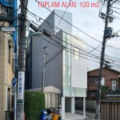

				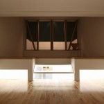

				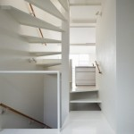

				

				

				

				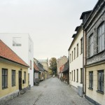

				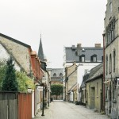

				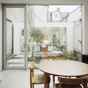

				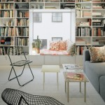

				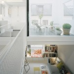

				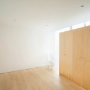

				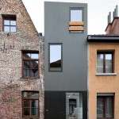

				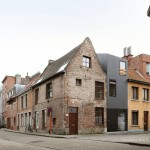

				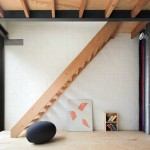

				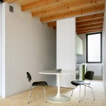

				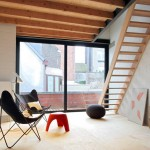

				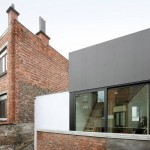

				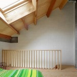

				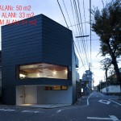

				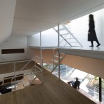

				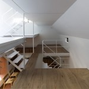

				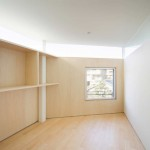

				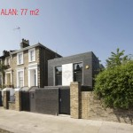

				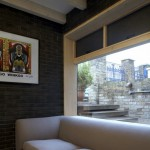

				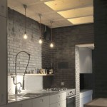

				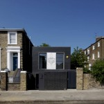

				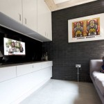

				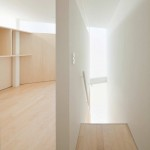

				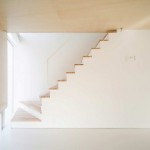

				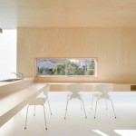

				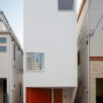

				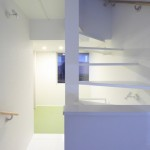

				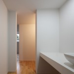
