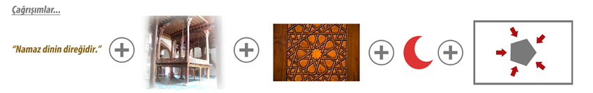
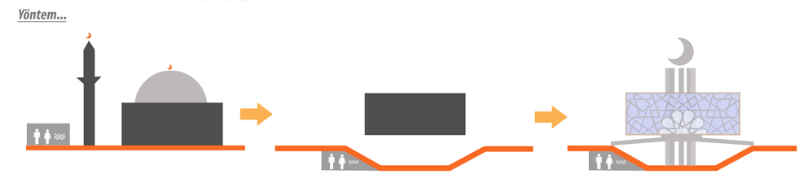
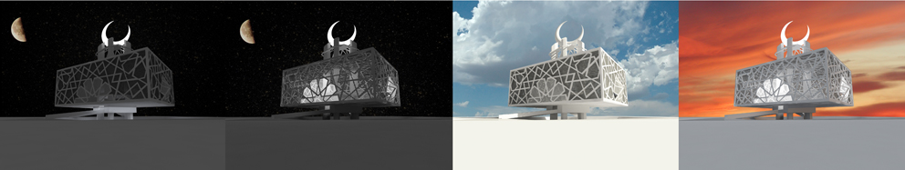
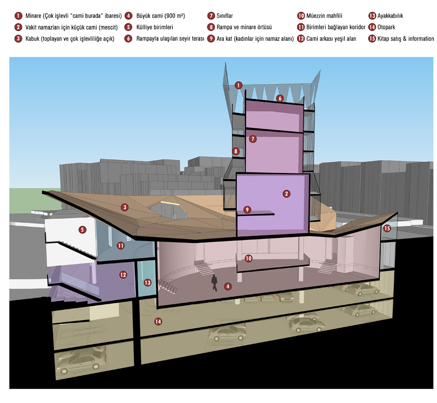
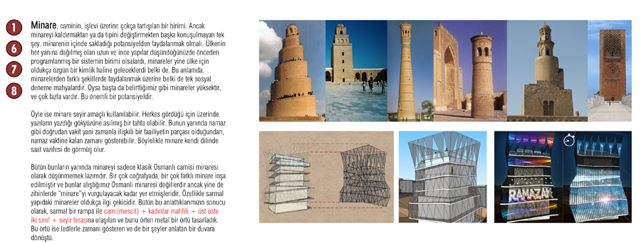
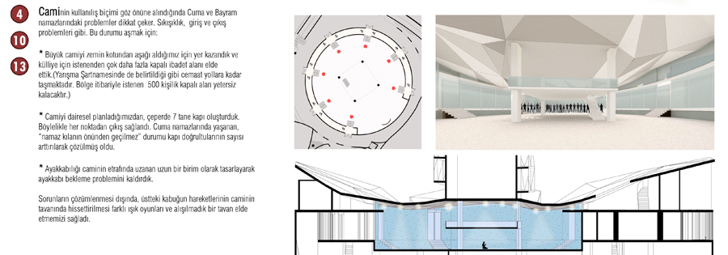
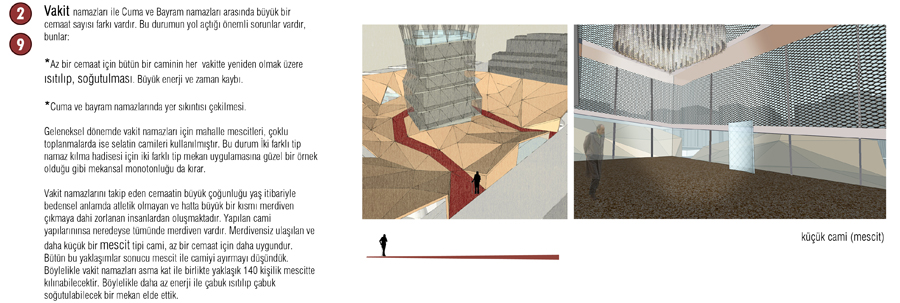

# SDMIM’in iki farklı cami tasarımı:

**Tarih:** 2012-09-17T18:16:33+00:00  
**Orijinal Kaynak:** http://sdmimproje.com/sdmimin-iki-farkli-cami-tasarimi/  
**Arşiv Zaman Damgası:** 20140106155841  
**Etiketler:** Depreme Dayanıklı Yapı, İstanbul, İslam & Medeniyet Tasavvuru, Müstakil Yaşam & Hürriyet, Apartman & Dikey Şehirleşme Eleştirisi, Cami Mimarisi & Kubbe  
**Atlas Düğümleri:** afet_deprem, sehir_hukuku, medeniyet, mustakil_yasam, apartman_elestirisi  

---

serkan duman **mimarlık**’ın cami mimarisi adına yaptığı iki yoruma değineceğiz.

Türkiye’de cami mimarisi yeni yeni tartışılmaya başlandı. Sevindirici olan bu.

Düşündürücü olansa, kendilerini birbirinden uzak iki farklı kutup sanan (bizce birbirlerinden ontolojik olarak çok da ayrılmayan) kesimlerin, caminin sadece “tip”i üzerinden konuşması.

Şöyle ki; bir kesim sözde “Osmanlı”cı yada tarihselci (ki tarihselcilik sandıkları şeye tarihselci de denemez bizce) davranırken. Diğer kesim ise caminin “tarihi” birşey dışında herhangi birşeye benzemesi gerektiğini düşünüyor.

Yani iki taraf da bir bakıma aynı şeyden bahsediyor: “caminin tipi”

SDMIM, 2009 ve 2012′de yaptığı denemelerle caminin tipten öte, günümüzde kullanılış biçimini sorgulayarak cevaplar arıyor.

İslam mimarisi sürekli değişim gösteren bir yapıda olmuş. Bu, coğrafya ve zamana göre değişiyor. Sanılanın aksine, islam değişime fazlasıyla açık. Bu durum bize ihtiyacın ve dünyaya bakış biçiminin değişiminin yapıya olan farklı etkilerini anlatıyor.

[İslam Coğrafyasından Tarihi Yapılar](http://vimeo.com/49605520) from [sdmim](http://vimeo.com/user9386317) on [Vimeo](http://vimeo.com).

Günümüzde, Türkiye’deki müslümanların, cami ile olan ilişkilerini sorguladığımızda ortaya yarım saate sıkıştırılmış bir cuma namazı, senede iki kere kılınan bayram namazları, ara sıra düşük katılımla kılınan vakit namazları çıkıyor. Bunun yanında yoğun ve problemli Türkiye şehirciliğinde oldukça önemli yeri olan, cami avlularının nefes aldırması, depremde kaçılabilecek yerler olması ya da camilerin çoğu insanın aklına tuvaleti (Türkiye’de insanlar wc ihtiyacı için genelde cami ararlar) getirmesi de unutulmamalı. Hakikatte ibadethanelerin modern insan ile ilişkişi işte bu minval üzerinde seyrediyor. Bu gerçeklerden hareketle, caminin insan hayatına daha çok katıldığı, insanın da cami ile daha rahat ve sık ilişkilenebildiği çözümler üretmek aynı zamanda hem maddi hem manevi yaşantı için camilerin barındırdığı potansiyelden faydalanabilmek önemli. Ancak bunu başarabilmek, öncelikle camiyi ve kullanılış biçimini doğru değerlendirmekten geçiyor.

Bu bağlamda serkan duman mimarlık, 2009 daki çalışmasıyla cuma ve bayram namazlarındaki sıkışıklık ve zaman kaybından hareketle, mananın maddeleştiği bir deneme yapıyor.

# **1)**

[serkan duman mimarlık – dinin direği ](http://www.sdmim.com/CAMI-TASARIMI-DININ-DIREGI-MAIN-PILLAR-OF-THE-RELIGION-pd8-pid5.aspx)

Cuma namazlarındaki, “namaz kılanın önünden geçilmez” problemine çözüm arıyor.

Çağrışımlar ve oluşum

“Namaz dinin direğidir.” Hadis’inden yola çıkarak, vaizlerin sıklıkla kullandığı: “Namaz dinin direğidir, işte şu kolonlar olmasa bu kubbe düşer, namaz da dini öyle ayakta tutar.” ifadelerini maddeleştiriyor.

Yöntem

[dinin direği / main pillar of the religion (cami tasarımı / mosque design) sdmim.com](http://vimeo.com/42762612) from [sdmim](http://vimeo.com/user9386317) on [Vimeo](http://vimeo.com).

Vakit – cami değişimi

2012′de ise Şişli’de Halide Edip Adıvar Mahallesi için bir deneme gerçekleştiriyor SDMIM.

**2)**

[serkan duman mimarlık – HEA Camisi (Külliye)](http://www.sdmim.com/HEA-CAMISI-KULLIYE-pd20-pid16.aspx)

Bu sefer arayışlar biraz daha kapsamlı.

Günümüzde cuma ve bayram namazı gibi çok insan ile kılınan namazlarda, cemaate yetmeyen cami, vakit namazlarında ise az bir cemaat için **ısıtılmaya ya da soğutulmaya** çalışılıyor. Büyük enerji kaybına sebep olan bu duruma SDMIM, üstte mahalle mescidi altta ise büyük bir cami önererek çözüm arıyor. Az cemaat için küçük hacim kullanılıyor böylelikle enerji boşa harcanmamış oluyor. Cuma ve bayram namazları için alttaki büyük cami kullanılıyor.

Yine vakit namazlarını takip eden cemaatin yaş ortalaması göz önüne alındığında, yaşlı kullanıcılar çoğunlukta olduğundan, “merdivensiz” bir cami olmalı diyor.

Minarenin mevcut potansiyeli üzerinde duruyor ve vaktin algılanabildiği, sanatçıların çalışmalarının sergilenebileceği gökyüzüne asılacak bir tahta öneriyor.

Birçok kişinin merak ettiği ama çıkamadığı minareyi bir seyir terası olarak tasarlıyor.

Mahalle mescidi olarak tasarlanan aynı zamanda minare olan yapının etrafını ise boş bırakarak kamuya açıyor. Avlunun önemini vurguluyor. Marmara depreminde, İstanbullular’ın yoğun apartman blokları arasındaki **cami avlularına kaçışlarını** örnek alıyor.

Büyük caminin bir çok yerinden giriş çıkış vererek rahat bir sirkülasyon hedefliyor. Ve cuma ve bayram namazlarında yaşanan ayakkabı bekleme ve çıkış problemini aşmaya çalışıyor. Caminin tipinden ziyade, bu konular üstünde duruyor.

Kesit perspektif

Minare ?

Büyük cami

Küçük cami (mahalle mescidi)

Kabuk

Camilerin hakikaten yaşama dahil olması için, hakikati aramaya çabalayan öneriler şart bizce…

**sdmimproje**
