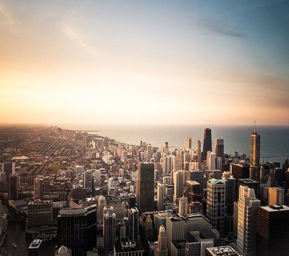

# ŞEHİRCİLİK – Kent Planlamasının Tarihi – A.K.K.K. 03

**Tarih:** 12/12/2019  
**Orijinal Kaynak:** http://sdmimproje.com/sehircilik-kent-planlamasinin-tarihi-a-k-k-k-03/  
**Arşiv Zaman Damgası:** 20191218023406  
**Etiketler:** Mimar Sinan, Le Corbusier, İstanbul, Fas & Mağrip, Paris, Şehir Hukuku & Şehircilik, Apartman & Dikey Şehirleşme Eleştirisi, Cami Mimarisi & Kubbe, Kapitalizm & Çevre, Kırsal Mimari, Köy & Kaçış  
**Atlas Düğümleri:** medeniyet, apartman_elestirisi, sehir_hukuku, dogu_bati, cansever, kapitalizm_mulkiyet, kirsal_koy  

---

Mimar Serkan Duman her Cuma canlı yayında. Bu canlı yayında şehircilik, şehir planlaması, şehir plancılığı gibi konuları konuşuyoruz. İlk kentler, ilk planlı kentler, coğrafyaya göre planlama değişimleri.

Bize destek olabilirsiniz: [https://www.patreon.com/sdmimproje](https://www.youtube.com/redirect?q=https%3A%2F%2Fwww.patreon.com%2Fsdmimproje&v=S1wY3qSUZhA&event=video_description&redir_token=IhKCiTxXpYrCHRF-GwVJg5EZMZF8MTU3NjIyMjIyOUAxNTc2MTM1ODI5)

Podcast havasında aynı zamanda görsellerle desteklenmiş bir söyleşi.

[#mimari](https://www.youtube.com/results?search_query=%23mimari) [#tasarım](https://www.youtube.com/results?search_query=%23tasar%C4%B1m) [#kent](https://www.youtube.com/results?search_query=%23kent)

“Akılda Kalacağına Kayıtta Kalsın” isimli canlı yayınımızın 3. bölümü. [0:12](https://www.youtube.com/watch?v=S1wY3qSUZhA&t=12s) Açılış [0:42](https://www.youtube.com/watch?v=S1wY3qSUZhA&t=42s) Göbeklitepe mimari ve şehircilik açısından ne ifade eder? [1:57](https://www.youtube.com/watch?v=S1wY3qSUZhA&t=117s) İnsanoğlu korunmak için önce ne yaptı? [2:36](https://www.youtube.com/watch?v=S1wY3qSUZhA&t=156s) Çatalhöyük nasıl bir yerleşimdi? [3:00](https://www.youtube.com/watch?v=S1wY3qSUZhA&t=180s) Fas ve Kasbah [3:47](https://www.youtube.com/watch?v=S1wY3qSUZhA&t=227s) Şehir (kent) nedir? Nasıl ortaya çıktı? [5:21](https://www.youtube.com/watch?v=S1wY3qSUZhA&t=321s) Bilinen ilk şehir hangisidir? [5:57](https://www.youtube.com/watch?v=S1wY3qSUZhA&t=357s) İlk kent planlaması nerede yapıldı? [7:03](https://www.youtube.com/watch?v=S1wY3qSUZhA&t=423s) Hippodamos ilk şehir planlayıcısı mı? [7:34](https://www.youtube.com/watch?v=S1wY3qSUZhA&t=454s) Grid veya Izgara plan nedir? [8:18](https://www.youtube.com/watch?v=S1wY3qSUZhA&t=498s) Aristo şehir ilişkisi [8:58](https://www.youtube.com/watch?v=S1wY3qSUZhA&t=538s) Tarih sadece yazılı mı olmalıdır? [10:00](https://www.youtube.com/watch?v=S1wY3qSUZhA&t=600s) Hippodamos kentleri [10:27](https://www.youtube.com/watch?v=S1wY3qSUZhA&t=627s) Büyük iskenderin şehirleri [10:42](https://www.youtube.com/watch?v=S1wY3qSUZhA&t=642s) Yunan şehir planlaması [11:17](https://www.youtube.com/watch?v=S1wY3qSUZhA&t=677s) Akropolis ve Antik Yunan kenti [11:32](https://www.youtube.com/watch?v=S1wY3qSUZhA&t=692s) Osmanlı şehirciliği ve Yunan şehirciliği [11:59](https://www.youtube.com/watch?v=S1wY3qSUZhA&t=719s) Doğanın kent planlamacılığı ile ilişkisi [13:15](https://www.youtube.com/watch?v=S1wY3qSUZhA&t=795s) Antik Roma kenti ızgara plan [13:51](https://www.youtube.com/watch?v=S1wY3qSUZhA&t=831s) Antik Yunan ve Roma tiyatroları [15:09](https://www.youtube.com/watch?v=S1wY3qSUZhA&t=909s) Pensilvanya Philadelphia kent planı [15:41](https://www.youtube.com/watch?v=S1wY3qSUZhA&t=941s) Roma neden ızgara planı çok kullandı? [16:50](https://www.youtube.com/watch?v=S1wY3qSUZhA&t=1010s) Washington kent planı [17:02](https://www.youtube.com/watch?v=S1wY3qSUZhA&t=1022s) 1666 Londra yangını ve planlaması [17:12](https://www.youtube.com/watch?v=S1wY3qSUZhA&t=1032s) Mimar Christopher Wren planı [17:18](https://www.youtube.com/watch?v=S1wY3qSUZhA&t=1038s) Merceğin bulunmasının şehir planlamasına etkisi [18:24](https://www.youtube.com/watch?v=S1wY3qSUZhA&t=1104s) İngiltere ve Amerika’nın Mimar Sinan’ı kim? [19:08](https://www.youtube.com/watch?v=S1wY3qSUZhA&t=1148s) Kapitalizm ve kent planlamacılığı [19:53](https://www.youtube.com/watch?v=S1wY3qSUZhA&t=1193s) Barselona kent planı [20:52](https://www.youtube.com/watch?v=S1wY3qSUZhA&t=1252s) Gaudi Barselona [21:03](https://www.youtube.com/watch?v=S1wY3qSUZhA&t=1263s) Paris kent planı [21:18](https://www.youtube.com/watch?v=S1wY3qSUZhA&t=1278s) Hausmann kimdir? [21:41](https://www.youtube.com/watch?v=S1wY3qSUZhA&t=1301s) Paris şehir planı militarist mi? [22:00](https://www.youtube.com/watch?v=S1wY3qSUZhA&t=1320s) Bağdat ilk planlı İslam şehri mi? [23:40](https://www.youtube.com/watch?v=S1wY3qSUZhA&t=1420s) İlk İslam şehri Kufe [25:59](https://www.youtube.com/watch?v=S1wY3qSUZhA&t=1559s) Samarra ve yeni planlama [26:47](https://www.youtube.com/watch?v=S1wY3qSUZhA&t=1607s) Müzik arası [32:26](https://www.youtube.com/watch?v=S1wY3qSUZhA&t=1946s) İkinci Bölüm [32:51](https://www.youtube.com/watch?v=S1wY3qSUZhA&t=1971s) Geleneksel Şehirler [34:44](https://www.youtube.com/watch?v=S1wY3qSUZhA&t=2084s) Libya Ghadames Şehri [36:12](https://www.youtube.com/watch?v=S1wY3qSUZhA&t=2172s) Arnavutluk Berat Şehri [36:38](https://www.youtube.com/watch?v=S1wY3qSUZhA&t=2198s) İslam Şehirciliği [38:10](https://www.youtube.com/watch?v=S1wY3qSUZhA&t=2290s) Titus Burchardt ve İstanbul [38:24](https://www.youtube.com/watch?v=S1wY3qSUZhA&t=2304s) İran Köyleri [39:26](https://www.youtube.com/watch?v=S1wY3qSUZhA&t=2366s) Yörük köyü ve topografyaya göre şekillenme [39:40](https://www.youtube.com/watch?v=S1wY3qSUZhA&t=2380s) Mihrimah Sultan Camisi [40:16](https://www.youtube.com/watch?v=S1wY3qSUZhA&t=2416s) Rönesans ve İdeal Şehir [41:57](https://www.youtube.com/watch?v=S1wY3qSUZhA&t=2517s) Bahçekent Şehir Tasarımı Ebenezer Howard [42:38](https://www.youtube.com/watch?v=S1wY3qSUZhA&t=2558s) Le Corbusier Şehirciliği [43:02](https://www.youtube.com/watch?v=S1wY3qSUZhA&t=2582s) Nazi Kentçiliği [43:22](https://www.youtube.com/watch?v=S1wY3qSUZhA&t=2602s) Venezuela Karakas ilginç dikey gecekondulaşma [44:32](https://www.youtube.com/watch?v=S1wY3qSUZhA&t=2672s) Brezilya Rio Favela Gecekondular [45:00](https://www.youtube.com/watch?v=S1wY3qSUZhA&t=2700s) Korkulan Brezilya gecekonduları [45:10](https://www.youtube.com/watch?v=S1wY3qSUZhA&t=2710s) Planlı Şehir Plansız Şehir ve Denetim [47:15](https://www.youtube.com/watch?v=S1wY3qSUZhA&t=2835s) Yeni Plancılık İnternet [48:44](https://www.youtube.com/watch?v=S1wY3qSUZhA&t=2924s) Ralph ve İnternet [48:58](https://www.youtube.com/watch?v=S1wY3qSUZhA&t=2938s) Kapanış
