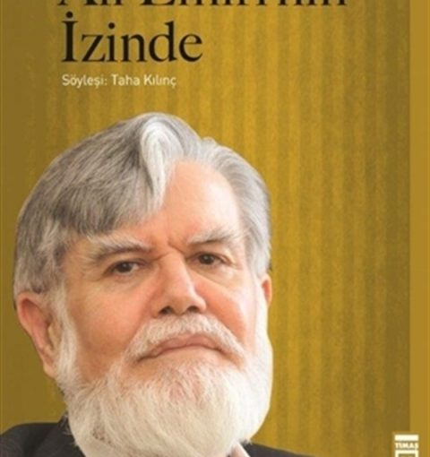

# Serhan Tayşi 2009’da İzmir için ne dedi?

**Tarih:** 02/06/2018  
**Orijinal Kaynak:** /sdmimproje/serhan-taysi-2009da-izmir-icin-ne-dedi.html  
**Arşiv Zaman Damgası:** 20190825030938  
**Etiketler:** Serhan Taysi, Geleneksel Ahşap & Hımış, Su Bağımsızlığı & Yağmur Hasadı, Depreme Dayanıklı Yapı, İslam & Medeniyet Tasavvuru, Müstakil Yaşam & Hürriyet, Apartman & Dikey Şehirleşme Eleştirisi, Cami Mimarisi & Kubbe  
**Atlas Düğümleri:** sehir_hukuku, geleneksel_ahsap, su_hasadi, afet_deprem, medeniyet, mustakil_yasam, apartman_elestirisi  

---

**Çocukluğumun İzmir’i**

> 

Çocukluğumun, yani 1950’li yılların İzmir’ini iki kelimeyle özetlememi isteseler, seçeceğim kelimeler şunlar olurdu: Küçük ve temiz. Gerek şehrin içi, gerekse körfez tertemizdi. Kordon boyunu boydan boya kapatan binalar henüz inşa edilmemişti. denizden esen imbat, ta içerilere kadar sokulur, en sıcak yaz aylarında bile şehre güzel bir serinlik verirdi.

İzmir Körfezi o kadar temizdi ki, sahildeki kayaların üstüne oturur, ucunu kıvırdığımız toplu iğnelerle balık avlardık. İğnenin ucuna, ağzımızda çiğnediğimiz ekmek parçacıklarını takar, ince bir iple denize sallardık olta gibi. O şekilde avladığımız balıklarla kendimize çok ziyafet çekmişizdir çocukluğumda. İzmir’de balık böyle boldu, bol olduğu için de sudan ucuzdu. Deniz öyle temizdi ki, kıyıda para atsan, cam gibi görünürdü denizin dibinde.

Denizin temizliği şuradan da belli ki, benim çocukluğumda, İzmir Körfezin’de yunus balıkları zıplardı suyun üzerinde. Hem de günün her vaktinde…

İzmir’de baskın bir Girit mutfağı kültürü vardı benim çocukluğumda. Sahil memleketi olduğundan, deniz mahsüllerinin her türlü yemekleri yapılırdı.Giritliler, kırlangıç balığı çorbası, kayabalığı çorbası, ahtapot çorbası gibi lezzetleri İzmir mutfağına sokmuşlardı.

Biz çocukken sahilden midye avlar, onları İngiliz bahçesinde yaktığımız ateşte pişirir yerdik. İngiliz Bahçesi bizim evin hemen altından başlar, Halil Rıfat Paşa’nın alt kısmından, Karataş’a kadar uzanırdı. İngiliz Bahçesi’nde yüzlerce çitlembik ağacı bulunurdu. Aşağıda bahsi geçecek olan Yahudi Mahallesi, İngiliz Bahçesi’nin hemen altındaydı. İngiliz Bahçesi, Yahudi Mahallesi ile Halil Rıfat Paşa arasında, kocaman yeşillik bir alandı.

İngiliz Bahçesi’nde nefis su kaynakları vardı. Ayrıca her türlü bitki de yetişirdi orada. Eşrefpaşalılar orada keçileri otlatır, pikniğe çıkarlar, çitlembik toplayıp yerlerdi.

Sahilden topladığımız midyeleri, İngiliz Bahçesi’ne götürürdük. Yaktığımız ateşte, midyeler hemen açılır, biz de temizleyip yerdik onları. Ama esaslı bir midye ziyafeti çekmek isteyenlerin, İzmir sahiline gitmeleri gerekirdi. Çünkü orada, midyenin her türlü yemeği yapılırdı.

İzmir şehir merkezinde, sahil boyunca, kıyıda Yahudihane denilen, iki-üç katlı binalar vardı. Yahudi aileler burada toplu halde yaşarlardı. Karataş-Üçkuyular semtleri arasındaki bu Yahudihaneler, İsrail’de şimdi uygulanan ‘Kibbutz’ sistemi gibi, Yahudilerin yardımlaşma ve dayanışma içinde yaşadıkları yerlerdi.

Benim çocukluğumda, İzmir’de hatırı sayılır bir Yahudi nüfus vardı. Mahalleleri de Müslüman mahallelerine yakındı. Hatta sahildeki Karataş Ortaokulu’nun tam karşısında bir havra vardı. Oranın hahmını gidip kızdırırdık çocukken. Adamcağız da çıkıp bize karşılık verirdi.

Eski İzmir’in sembollerinden biri de Sarıkışla idi. Sarı malta taşlarından yapıldığı için bu adı alan kışla, 1800’lerin ilk yarısında inşa edilmiş. Biz İzmir’e geldikten kısa bir süre sonra, 1953 yılında, İzmir Beldiyesi bu harika binayı yıktı ne yazık ki. Sarıkışla, Konak Meydanı’nda, Konak Camii’nin yanında bulunuyordu.

Ta Üçkuyular’a kadar sahilde yalılar ve ahşap kabinli plajlar bulunuyordu. Bu plajlarda yer yer, ‘deniz hamamı’ bulunurdu. Hanımlara tahsis edilen deniz hamamları, denizin içine doğru devam eden tahta perdelerden yapılırdı. Hanımlar burada, yabancılara görünmeden, serbestçe denize girebilirlerdi.

İzmir’in mis gibi havası, esintili körfezi, tertemiz denizi, ne yazık ki yanlış şehirleşme sebebi ile katledildi. Evvela kordon boyuna blok apartmanlar yapıldı. O apartmanlar, dil bir set halinde, imbat rüzgârının içerileri serinletmesini imkânsız hale getirdiler. Hâlbuki yazları İzmir’de rahat yaşamayı temin eden şey imbat rüzgârıydı. İmbat, denizden karaya doğru esen serin rüzgârın adıdır. İkindi üzeri saat dört buçuk gibi çıkar, gece yarıdan sonraya kadar devam eder.

Hatırlıyorum, Eşrefpaşa’daki evimizin balkonunda, o imbatın serinliğinde ders çalışmak gibisi yoktu. Sonraları bu imkânı kaybettik ne yazık ki…

Yine gerekli tedbirlerin zamanında alınmayışı sebebiyle, İzmir Körfezi kirlendi, bırakın balık avlamayı, denizin rengi bile kayboldu.

İzmir’in başına gelen bir diğer felaket, meşhur belediye reisi Osman Kibar’dı. Ya da çok bilinen ismiyle söylersek: Asfalt Osman. “İzmir’in bütün sokaklarını asfalt yapacağım” sloganıyla, bütün arnavut kaldırımlarının, harika taş sokakların, hatta sahildeki tramvay hattının bile üzerine asfalt döken Asfalt Osman’ın bu yanlış politikası, İzmir’in havasını berbat etti. Altyapısı olmayan birçok caddelerde, yağmur suyunu emen parke taşları kaldırıldığı için, İzmir’de senelerce her yağmurdan sonra sel baskınları oldu.

Eski İzmir’in sokakları, caddeleri taş döşeliydi. Ara sokaklarda, Eşrefpaşa’da, Karataş’ın üst mahallelerinde çok güzel taş sokaklar, Arnavut kaldırımlı yollar vardı. Taş, yazın çok sıcak vermiyor dışarı. Yere bastığınızda, ayaklarınız yanmıyor sıcaktan. Halbuki asfalt, hem zemine soluk aldırmıyor, hem de kaynıyor. Ayrıca taş döşeli bir yolda, kışın yağan yağmurlar da kolayca toprak tarafından emiliyor. Bir yerde bozulma olduğunda ya da altyapı çalışmaları yapılacağında, taşlar kaldırılıyor, sonra yerine takılıyor kolayca.

**M. Serhan Tayşi Kitabı- Ali Emîrî’nin İzinde**