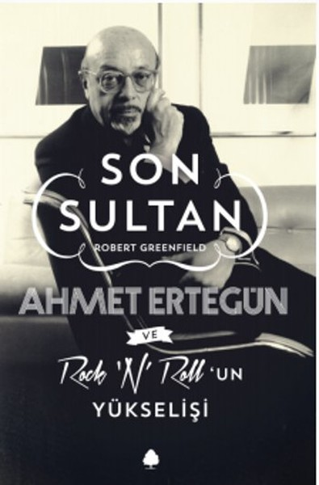

# Son Sultan – Ahmet Ertegün ve Rock’n Roll’un Yükselişi

**Tarih:** 17/02/2018  
**Orijinal Kaynak:** /sdmimproje/son-sultan-ahmet-ertegun-ve-rockn-rollun-yukselisi.html  
**Arşiv Zaman Damgası:** 20221006135020  
**Etiketler:** Ahmet Ertegün, Doğu-Batı Ayrımı, İslam & Medeniyet Tasavvuru  
**Atlas Düğümleri:** felsefe_sanat, dogu_bati, medeniyet  

---

Son Sultan – Ahmet Ertegün ve Rock’n Roll’un Yükselişi – Robert Greenfield
