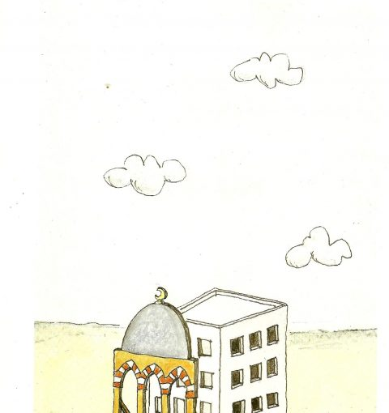

# Sosyal Medya ve Geleneksel Mimari

**Tarih:** 01/12/2018  
**Orijinal Kaynak:** /sdmimproje/sosyal-medya-ve-geleneksel-mimari.html  
**Arşiv Zaman Damgası:** 20190302175418  
**Etiketler:** Marshall Berman, İstanbul, Şehir Hukuku & Şehircilik  
**Atlas Düğümleri:** apartman_elestirisi, sehir_hukuku  

---

Bir dönem en kolay hobi edinme yöntemlerinden birisi olarak, profesyonel fotoğraf makinası edinme furyası başlamıştı. Sosyal medya, meşhur fotoğrafçılara özenerek çekilen fakir insan veya ayağı çıplak çocuk fotoğraflarının hakimiyetindeydi. Çekenin kendi ilgisinden ziyade “insanlar buna ilgi gösterir” diyor gibi paylaştığı bu fotoğraflar, yerini eski bina görsellerine bırakmış durumda. Öyle ya cep telefonlarının fotoğrafı en kaliteli biçimde bünyesine dahil etmesi, objektifi olmayan bu aletlerin insana tutulmasını anlamsız kıldı. Sokağın birindeki yıkılmaya yüz tutumuş bir tarihi yapıyı fotoğraflamak, hem haber niteliği taşıması hem de kültürel bilinç düzeyini! göstermesi açısından daha mantıklı hale geldi. O kadar çok insan tarihine “sahip” çıkıyor ki, ister istemez “peki nerede bu tarih düşmaları” diye sorası geliyor insanın.

Karl Marx’ın  meşhur “katı olan her şey buharlaşıyor” sözü basitçe, maddi faydası olmayan şeylerin tedavülden kalkması olarak düşünülebilir. Sosyal medyanın popüler konuları da bu sözden şüphesiz nasibini alır. Günümüz tarihi mimari popülaritesine bakacak olursak, beğeni alıyor ki, bu konu gündemde dememiz gerekiyor. Eski bir bina bulup, görselin üzerinden yöneticilere veya birilerine sitem etmek ya da ne kadar güzel olduğunu ifade etmek, “ah nerede o eski şehirler” demek, sosyal medyada ekmek getiren konulardan.

Elbette sayıları az da olsa bazı teknik insanlar ve duyarlı yazarlar uzun yıllardır şehir ve mimari üzerine çalışıyor ve yazıyorlar. Ancak durumu eyleme geçirenlerin sayısı oldukça az olduğu gibi onlara destek çıkanların sayısı da azdı. Dünyanın geldiği durum olarak ülkemizde de eskiye nazaran konuya eğilenlerin sayısı artmış durumda. Ancak sorun şu ki, rüzgarın estiği doğrultuya göre konum alanların her zaman yaptıkları gibi meseleyi kendi seviyelerine indirme ve sulandırma girişimleri…

Konuşmak yapmaktan daha zordur. Aynı zamanda salt konuşmak olguların içini boşaltıp kabuk haline getirir. İşte sosyal medyada olan durum da bu. Kalabalıklar aynı şeyi yüksek sesle konuşmaya başladıklarında, önemli meselelerin sümen altı edileceği tehlikesi ortaya çıkmaya başlar. Çünkü kalabalık detayı görmek istemez, popüler olanla, kabukla ve kolay anlaşılabilir olanla etkileşime girebilir ancak.

Bir hakikati bulduğunuzda, gerçekten onun hakikat olduğunu düşünüyorsanız, hayatınızı o düşünce çerçevesinde düzenlemeye başlarsınız. Bu da sizin belli noktalarda ana akımdan çıkmanıza ve kendi yolunuzu yürümenize neden olur. Ancak bu zorlukla baş etmek istemeyenler, genelin o doğrultuya girmesini beklerler. Bu düşüncede olanların sayısı arttıkça da, aynı düşüncede olmayanları da zorla yola almak isterler. İşte günümüzde artan geleneksel mimari ve eski şehircilik akımının durumu da bu. Uzun yıllar düzenin içinde herhangi bir şey yapmadan dönüp duran insanların, kendi icat ettikleri ve yine kendilerine göre yonttukları bir takım “gelenek”, “Türk evi”, “dini mimari” gibi kavramları yüceltmeleri ve hala bir şey yapmadan meselenin yapılabilir hale gelmesini beklemeleri de sorunlu bir tutum.

Bu noktada olması gereken, insanlara olguları zorla benimsetmek değil, ortaya hem pratik hem de teorik anlamda ürün çıkararak “durum bu” diyerek toplumun önüne koymaktır. Toplum eğer gerçekten olumlu yaklaşırsa zaten durum kendi halinde değişime gidecektir. Tepeden inmecilikten çok çekmiş bir ülke olarak, güzel yaptığını düşünen insanların çirkinlikleri ile boğuşurken, yüzeysel gelenekçiliğin “ah nerede o eski İstanbul”culuğunun yeni sorunlar doğurmaması dileğiyle.

