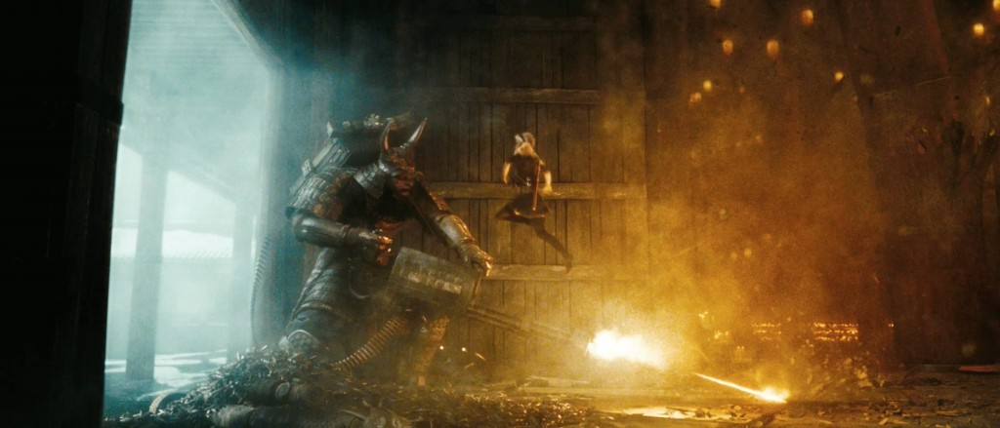
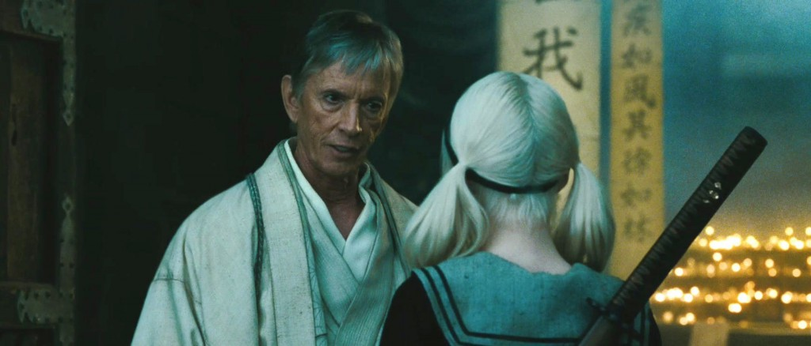
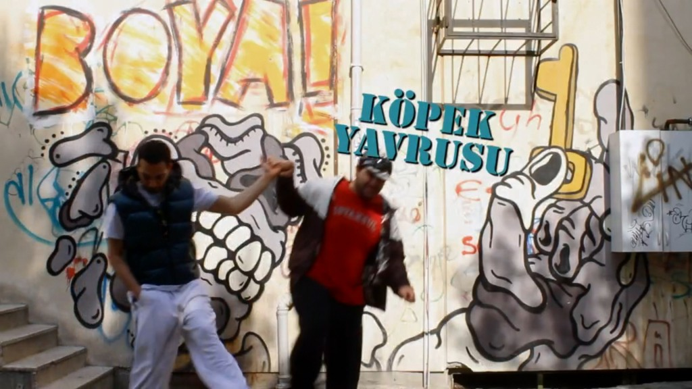
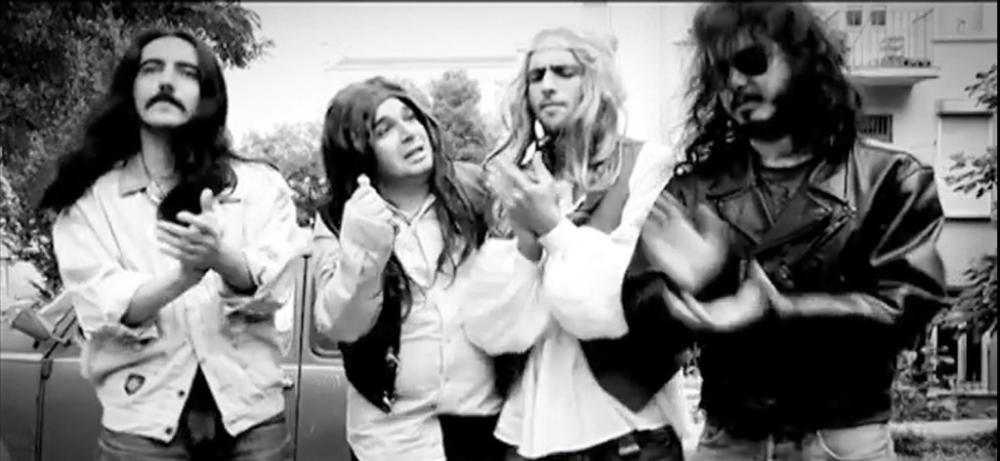
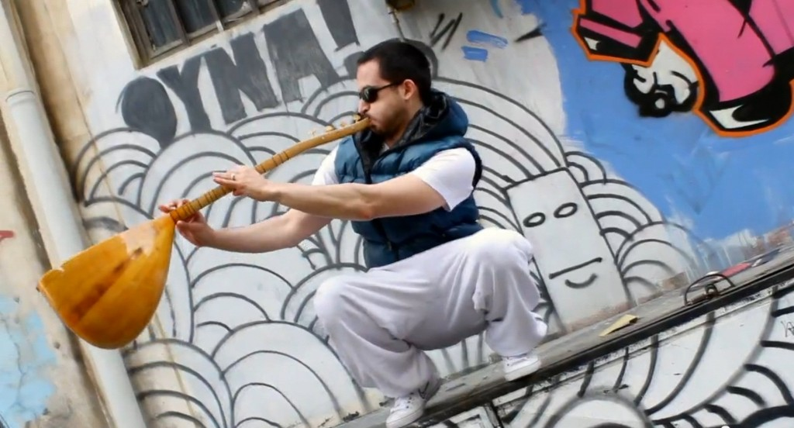

# Sucker Punch, Buz Gibi Biraderler, Tam Akbil ve Mimarlar Bağlamayı Neden Üfleyerek Çalamazlar?

**Tarih:** 2012-02-22T14:15:43+00:00  
**Orijinal Kaynak:** /sdmimproje/sucker-punch-buz-gibi-biraderler-tam-akbil-ve-mimarlar-baglamayi-neden-ufleyerek-calamazlar.html  
**Arşiv Zaman Damgası:** 20120614121652  
**Etiketler:** Depreme Dayanıklı Yapı, İslam & Medeniyet Tasavvuru, Apartman & Dikey Şehirleşme Eleştirisi, Postmodernizm & Tüketim Eleştirisi, Sinema & Mekân İdrakı, Kapitalizm & Çevre, Mimarlık Ortamı & Akademi Tenkidi  
**Atlas Düğümleri:** afet_deprem, medeniyet, apartman_elestirisi, goruntu_hakikat, kapitalizm_mulkiyet, mimarlik_egitimi  

---

***“sevdiğin bütün yemekleri blendırda karıştırıp yemeye çalışınca nasıl hissedersen, filmi izleyince de aynı hissi duyuyorsun.”***  grunger – ekşisözlük

Yukarıdaki söz “Sucker Punch” filmi için söylenmiş. Filmi anlatmak için doğru bir cümle, belki “sevdiğin” kelimesi üzerine düşünülebilir… Sucker Punch filminde dünyaya ait; zaman, coğrafya, kültürler, savaşlar, romanlar, gerçekler, kurgular, müzikler, sesler, makinalar, kıyafetler vb. birçok şey bağlamından koparılarak serbestçe dolaşıyor. Çağrışımlardan hareketle oluşturulmuş bir film izliyorsunuz. Açıkçası izlemeseniz de hiç bir şey kaybetmezsiniz ancak filmin bu yazıya; başlıkta adı geçen diğer videolar ile birlikte, ilham verdiğini söylememiz gerek.

sucker punch - samuray gibi bir şey ile lolita gibi birşeyin karşılaşması

İkinci dünya savaşı ortamına benzeyen bir savaş sahnesinin içinden, japon animesinden alınmış gibi duran “uzay gemisi robot karışımı” (ki dünyanın henüz görmediği bu tarz yüksek teknolojili araçlar da bir çok kere farklı kişiler tarafından kurgulanmış bir kurgusallıktır) ile kaçış, ya da kadim Çin’deki tapınaklar gibi olan bir mekanda yine robota benzeyen dev samurayın, taramalı tüfek kullanması bunun yanında kulağınıza rock müziği sesinin gelmesi ve daha bunun gibi bir çok tezatlıklar; filmin tam anlamıyla kurgulanmaya bile çalışılmamış bir çorba olduğu izlemini veriyor.

Peki Sucker Punch’ın önemi ne? Hiç bir önemi yok. Önemi de buradan geliyor zaten. Öyleyse önemi var?  -Kafa kakarışışıklığı iyidir!

Aslında mesele önem meselesi değil. Bir durum bilinçlenmesi. Doğrusunu söylemek gerekirse bu noktada postmodernizm kelimesini icat eden kişiye; -ki bazı söylentilere göre bu kişi: İngiliz ressam ve sanat kritiği John Watkins Champman’dır.- teşekkür etmeliyiz zira şimdi bahsedeceğimiz “durum”u anlatmak için bazı kelimelere ihtiyacımız var ve bu kelimeler de “postmodern”den türetilmiş şeyler. Bunun yanında Mike Feathersone: ” *Modern yerleşik düşünceler Sözlüğü’nün de onayladığı gibi “Postmodernizm’in hiçbir anlamı yoktur. Olabildiğince sık kullanın” (Independent, 24 Aralık 1987)* dediğini de unutmayalım  

Sucker Punch filminde hedeflenen “postmodern” bir film gibi duruyor. Tavır elbette postmodernist bir tavır değil ancak “çağdaş” ve ” yeni” kelimeleri sorgulanmış, bu açık. Tabi filmin altında felsefik bir yaklaşım da aramak doğru değil. Hedonistik bir tavır var ve dert nefsin hoşuna gidecek bir film üretmek olmuş. Ancak arayış işte burada devreye girmiş, bu dönemde ne nefsin hoşuna gider? F.Jameson: *“Kurgulanmış(hedeflenmiş) bir derinliksizlik”* diyor Postmodernizm için. Olabildiğine sığlaştırma, herşeyi işin içine sokma ve maksimum haz sağlama. Ya da odasında bütün bir insanlık tarihi bilgisi ve arşivi oyuncağı olan bir çocuğun hepsiyle birlikte oynama arzusu. Film biraz bu.

Nirvana'ya giden lol. Sağdan dön hemen orada.

Metnin başlığı konsept tamamlansın diye konuldu aslında. Başlık da yazının içeriği gibi. Sığ, karmaşık ve belki bir kaç yıl boyunca( o kadar sürer mi bilemiyoruz) ilgi çekici. Başlıkta “Buz gibi biraderler” diye bir kelime grubu dikkatinizden kaçmamıştır. Bilmeyenler için söyleyelim; buz gibi biraderler, Batesmotelpro grubunun yaptığı eğlencelik videolardan biri. İzlemek istiyorsanız, google, youtube gibi yerlerde aratarak anında ulaşabilirsiniz.

Sucker Punch filminde anlattığımız çağrışım çorbası, Buz Gibi Biraderler’de batı kültürü ve de geleneksel öğelerle bezenmiş bir Türkiye çağrışım çorbası haline gelmiş. Günümüz insanının veri bombardımanına tutulduğunu düşünürsek klişeler ve de alışılmışlıklar üzerinden anlık tepkiler verilip-alınıyor Batesmotelpro’nun bu videosunda. Bir kelime üzerine gelen alakasız çağrışım sorgulanmadan yerine konuyor ve klişe tepkiler de anında yerine yerleştirliyor.

köpek yavrusu: ayyyyy!

Buz Gibi Biraderler, bilinçli biçimde yapılmış bir veri çorbası videosu. Türkiye insanlarına hitab ediyor ve onların zihinlerinin içinde bulunduğu durumu anlatıyor. Zaten çağdaş bir ürün ortaya çıkarmak istiyorsanız önce ürünün muhatablarını anlamak zorundasınız yoksa sizin ürününüz de bir tezat olarak köşede kalır. Batesmotelpro üyeleri hergün milyonlarca çağrışım arasında yorulan zihinleri yormadan güldürecek videolar hazırlıyorlar ve de başarıyor gibi duruyorlar.

Gelelim Tam Akbil’e. Tam Akbil de Biraderler videosu gibi bir video. Ona da youtube’dan ulaşabilirsiniz. Tam Akbil yine görsel çağrışımların ve de uyumsuz bir nesnenin iç-içe girdiği bir video. 90 lar anlatılıyo deniyor ama gösellik 70′ler “gibi” bunun yanında işin içinde bir akbil var. Yani Biraderlerin yaptığının bir başka versyonu gibi. Tam Akbil ve benzeri videolar tezatlıkların bir arada bulunması durumunun ete kemiğe bürürünmüş halleri.

Tam Akbil

Peki mimarlık günümüz zihinleri için ne gibi üretimler yapıyor? Çok uzatmadan bir iki uluslararası örnek verip Türkiye mimarlık ortamına geçiş yapacağız.

Mimarlıkta postmodernizm denince akla ilk olarak görsel çorbalar yapmak gelebilir fakat biz bunun yeterli olacağını düşünmüyoruz daha doğrusu yukarıdaki videoların karşılığı mimaride bu kadar basit değil. Nasıl mı? Şöyle ki: Tezatların ve de çağrışımların dünyasında yapılar için farklı bir durum yaşanıyor ki bunlardan biri fonksiyonların iç-içe girmesi durumu. Yani farklı işlevli birimler bir arada bulunmaya başladı. Bundan bilinçli olarak ilk bahsedenlerin başında Rem Koolhas geliyor. New York’taki gökdelenin bilmem kaçıncı katında bulunan fitness salonu örneğini veriyor kendisi. Yani insan yaşayışının çağrışımsallığı yapı anlamında böyle farklılaşmalar taşıyabiliyor. Yoksa sadece görsellik karmaşaını düşünmemek lazım.

Mimaride görsel çağrışımlar. Michael Graves yapısı.

Oma projesi. Farklı fonksiyonların tektonikleşmesi ve bir aradalığı.

Fountainhead isimli kitabı okuyanlar bilir. 20. YY başı Amerikasın’da mimarlık ortamı anlatılır bu kitapta. Tarihselcilik ve de modernistlik ilişkisi üzerinde durulur. Şimdi 21.YY başlarında Türkiye’de de benzeri tartışmalar henüz yaşanıyor. Yani mimari anlamda bu tarışmaları yaşamaya geç kalmış bir ülkede yaşıyoruz.

Türkiye’de iki baskın türde inşai ürün çok veriliyor. Biri rasyonel diye nitelenebilecek modernist tutum diğeri ise “tarihselci” tutum. Tarihselci(bizce çağrışımcı da denebilir) tutum için şunu söyleyebiliriz. “Suyunun, suyunun, suyundan yapılmış bir çorbayı bir ara bir yerde içmiştim canım işte öyle bir çorba istiyor.” diyerek yapılan bir üretim. Yani çağrışım bile olamıyor. Aslında Türkiyede’ki mimari ortam bazen Batesmotelpro’nun videoları kadar komik olabiliyor!

Buz Gibi Biraderler’i yapanlar, kendi yaşadıkları çevre içerisinde, beraber yaşadıkları insanlara hitab eden kendi içinde tutarlı bir video yapmışlar. Oma ve benzeri ofisler de mimari açıdan en azından bunun arayışı içerisindeler. Ancak Türkiye gibi, hem müslüman, hem teknolojiyle fazlasıyla iç-içe, hem doğu hem de batı ile sürekli bağlantı içinde, hem dünyanın geri kalanı gibi batı kültürü etkisi altında, hem de son büyük imparatorlukların birinin bulunduğu ve de kadim topraklar üzerinde bulunan bir ülkede mimari ortam, hitab ettiği kesimin zeka seviyesinin altında üretimler yapmakta ve yeni doğrular arama çalışkanlığından uzakta görünüyor. İnsanların bağlamayı üfleyerek çalmayı bile denediğinin farkında değil Türkiye Mimarlık Ortamı.

bağlama üflemek...

**sdmimproje**