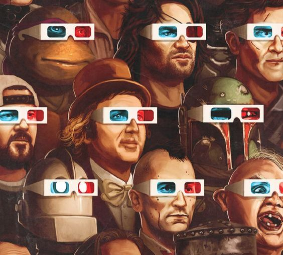

# Tanrım youtube’da bir klip izleyelim.

**Tarih:** 28/03/2015  
**Orijinal Kaynak:** http://sdmimproje.com/tanrim-youtubeda-bir-klip-izleyelim/  
**Arşiv Zaman Damgası:** 20190101192332  
**Etiketler:** Walter Benjamin, Müstakil Yaşam & Hürriyet, Postmodernizm & Tüketim Eleştirisi  
**Atlas Düğümleri:** apartman_elestirisi, mustakil_yasam, goruntu_hakikat  

---

Biraz görülebilir geleceğe göz atalım mı?

Felsefe felsefe içindi. Sonra felsefe bilim için oldu. Bugün ise felsefe bilim, bilim de para için…

Facebook, google, twitter gibi internet ürünlerinden büyük paralar yapan gençleri gören diğer insanlar ve özellikle gençler “yırtmak” adına bilimle uğraşmaya başladılar. Sosyal söylemli ifadeler ve informal giysilerle “postmodern dahilik” peşindeki bu “paraya hiç de önem vermeyen!” gençler dünyayı tırnak içinde “daha güzel” bir yer yapmanın yarışına giriştiler.

Nasıl olsa bulundukları yerden etkileyebilecekleri, satış yapabilecekleri, avuçlarının içine alabilecekleri bir insan sürüsü hazır bir biçimde, internet bağlantılı araçlarının zincirinde onları beklemekte.

Geçen gün kendini “insanlığın gelişmesine” adayan iki bilim adamı genci dinliyordum. Biri insanların izledikleri görüntülere zihinlerinin nasıl tepki verdiğini ölçmek istiyormuş. “Bunu hangi ulvi amaç için yapıyor acaba” diye düşünürken cevap gecikmedi: “Böylelikle reklam şirketleri reklamlarını daha efektif hale getirebilecek.”

Olayın nereye gideceği çok açık. Bir insan en çok hangi görüntüden etkileniyorsa, fark ettirmeden aynı etkiyi yapan görüntülerin kodlandığı reklamlar… Mesela bir vahşet görüntüsü ya da pornografik bir görüntünün beyne verdiği etkinin aynısını fark ettirmeden yapmak… Paradan daha önemli bir şey var mı ki? Her şey mübah…

Diğer aydınlanmış gencimiz ise unutulan şemsiyelere kafayı takmıştı. Şemsiyelere bir çip yerleştirerek unutulmalarını engelleyecekmiş. Bu buluşun bir arka planı ya da “ulvi” bir hedefi var mı bilmiyorum. Ama bu çip olayı beni geleceğe dair düşünmeye itti.

Şemsiyenin nerede olduğunun bilinmesi meselesini, kendisinin nerede olduğunun bilinmesini isteyen ve bunu sosyal medyada ısrarla paylaşan insanlarla bir araya getirirsek çok açık bir şeyle karşılaşırız. Nerede olduğunu sürekli bildiğimiz insanlar…

Derinin altına konacak çipler, göze yerleştirilen bilgisayarlar derken kimin nerede ne yaptığını sürekli anlamda bilebileceğimiz bir gelecek nelere gebe olabilir?

Elinizde tutmadığınız ve beyninizle doğrudan ilişkili cihazlarla sadece insanları değil, ulaşım araçlarını, şemsiyeleri, koltukları, montları kısacası herşeyin nerede olduğunu zihninizde bulacaksınız.

Zihniniz diğer insanların o an ne yaptığını biliyor olacak. Utanma duygusunun o geleceğe kadar ortadan kalkmış olacağını siz de kestirebilirsiniz. Zira bunun izleri güçlü bir şekilde bugünde mevcut. Paylaşılmayan bir şey kaldı mı?

Bu “zihni gelişmişlik” hoşunuza gitmiş olabilir. Ancak olması muhtemel “eğlence” tabi ki yanında eğlencesi oranında problemler getirecektir. Sizin de tahmin edebileceğiniz gibi: Zihin kontrolü…

İnsan kendi eliyle tanrı yaratmaya çağlar boyu meraklı olmuş. Altından buzağıyı komik bulacak günümüz insanının tanrısı en büyük akıl olmalıydı. (Altından buzağıya rahmet okutur.)

Google’a bakalım. Herşeyi biliyor mu? Biliyor. Arzuları besliyor mu? Kesinlikle. Her istediğimize anında ulaşabiliyor muyuz? Evet hemen herşeyi bize veriyor. Sürekli onunla beraber miyiz? Hep onu mu zikrediyoruz? Elbette. Sürekli yanımızda mı? Kalbimizde…(cebimizde çantamızda)

İşte google bile tanrı olmaya adayken bahsettiğim gelecekteki el yapımı tanrı meselesini görebilmek gerekli.

Kaçamayacağımız el ürünü tanrı, verdiği kadar da alacaktır. Verdiği sınırsız olduğuna göre…

Geçen gün bir mimarlık öğrencisine elindeki akıllı telefon ile google’da dolaşırken şunu sordum. “Bunun elinde değil de gözünde olmasını ister miydin? Yani ekran görüntüsü doğrudan gözünde var olsaydı da oradan yönetseydin.” Sorumun cevabı olumsuz olmadı.

Bizler modern insanlar olarak aklımıza çok güvendik. Ve o akılla nefsimiz için gereken her şeyi yaptık yapıyoruz da. Tanrıyı da arıyoruz. Ama o tanrıyı görmek istiyoruz. Göremiyor muyuz? Öyleyse biz yaratalım?

**bkz. [Ağzına sağlık Benjamin (Konut Hakkında)](/sdmimproje/agzina-saglik-benjamin-konut-hakkinda.html)**

**bkz. [Sen, Ben ve Recep İvedik](/sdmimproje/sen-ben-ve-recep-ivedik.html)**

**bkz. [sosyal medyalar da ağalar beyler](/sdmimproje/sosyal-medya-ve-geleneksel-mimari.html)**

**bkz. [Herhangi bir eve her zaman girebilirsin.](/sdmimproje/herhangi-bir-eve-her-zaman-girebilirsin.html)**

**serkan duman / sdmimproje**
