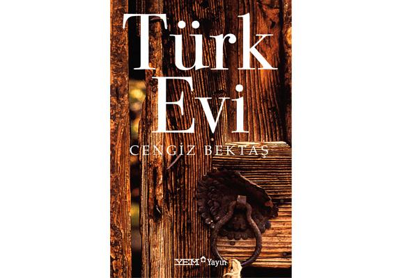

# Türk Evi

**Tarih:** 18/03/2015  
**Orijinal Kaynak:** http://sdmimproje.com/turk-evi/  
**Arşiv Zaman Damgası:** 20190704092721  
**Etiketler:** Cengiz Bektaş, Doğu-Batı Ayrımı, İslam & Medeniyet Tasavvuru  
**Atlas Düğümleri:** mimarlik_egitimi, dogu_bati, medeniyet  

---

Cengiz Bektaş – Türk Evi

**sdmimproje**
