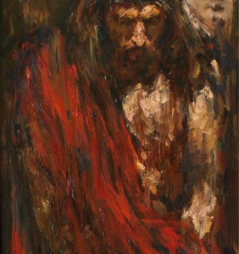
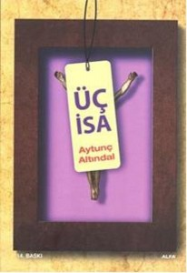

# Üç İsa

**Tarih:** 09/11/2016  
**Orijinal Kaynak:** /sdmimproje/uc-isa.html  
**Arşiv Zaman Damgası:** 20190101233906  
**Etiketler:** Doğu-Batı Ayrımı, İslam & Medeniyet Tasavvuru  
**Atlas Düğümleri:** dogu_bati, medeniyet  

---

Üç İsa – Aytunç Altındal

**sdmimproje**
