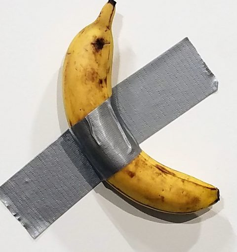

# Yemişim Sanatını – Muz Günlerinde Sanat – A.K.K.K. 05

**Tarih:** 11/12/2019  
**Orijinal Kaynak:** /sdmimproje/yemisim-sanatini-muz-gunlerinde-sanat-a-k-k-k-05.html  
**Arşiv Zaman Damgası:** 20191218023536  
**Etiketler:** Doğu-Batı Ayrımı, İslam & Medeniyet Tasavvuru  
**Atlas Düğümleri:** dogu_bati, medeniyet  

---

“Akılda Kalacağına Kayıtta Kalsın” serisinin bu bölümünde, Maurizio Cattelan’ın muzunu konuşuyoruz. [0:00](https://www.youtube.com/watch?v=Ntyit_kgdFo&t=0s) Maurizio Cattelan’ın Muz’u [1:05](https://www.youtube.com/watch?v=Ntyit_kgdFo&t=65s) Eser neden dikkat çekti? [https://www.patreon.com/sdmimproje](https://www.youtube.com/redirect?redir_token=B5ke63uF8EfqqF4R2z0ogRXBRuh8MTU3NjE1NzE2M0AxNTc2MDcwNzYz&q=https%3A%2F%2Fwww.patreon.com%2Fsdmimproje&event=video_description&v=Ntyit_kgdFo) [1:44](https://www.youtube.com/watch?v=Ntyit_kgdFo&t=104s) Eseri alan aile? Ne yapacaklar? [2:09](https://www.youtube.com/watch?v=Ntyit_kgdFo&t=129s) Andy Warhol Campell Çorbası eseri [2:24](https://www.youtube.com/watch?v=Ntyit_kgdFo&t=144s) Muz çürüyünce ne olacak? [3:06](https://www.youtube.com/watch?v=Ntyit_kgdFo&t=186s) Muzu yiyen David Datuna [3:20](https://www.youtube.com/watch?v=Ntyit_kgdFo&t=200s) Roderick Webber, Epstein yazdı [3:50](https://www.youtube.com/watch?v=Ntyit_kgdFo&t=230s) Bantlanmış muzun duvarı [4:39](https://www.youtube.com/watch?v=Ntyit_kgdFo&t=279s) Çürüyecek bir muz nasıl sanat eseri olur? [4:58](https://www.youtube.com/watch?v=Ntyit_kgdFo&t=298s) August Osage County ve T.S. Eliot [5:50](https://www.youtube.com/watch?v=Ntyit_kgdFo&t=350s) İnsanlara eğlence lazım! [6:38](https://www.youtube.com/watch?v=Ntyit_kgdFo&t=398s) “Bir kişinin yazdığı kitabı okumaktansa, onun iç çamaşır alışını izlemeyi tercih ederim.” [7:15](https://www.youtube.com/watch?v=Ntyit_kgdFo&t=435s) Andy Warhol ve Vlog [7:50](https://www.youtube.com/watch?v=Ntyit_kgdFo&t=470s) Maurizo Cattelan’ın diğer çalışmaları [8:24](https://www.youtube.com/watch?v=Ntyit_kgdFo&t=504s) Duchamp ve Fountain [8:40](https://www.youtube.com/watch?v=Ntyit_kgdFo&t=520s) Altın tuvalet Amerika [9:34](https://www.youtube.com/watch?v=Ntyit_kgdFo&t=574s) Antony Gormley Trafalgar [11:13](https://www.youtube.com/watch?v=Ntyit_kgdFo&t=673s) Muz kapanış 🙂 [#sanat](https://www.youtube.com/results?search_query=%23sanat) [#nane](https://www.youtube.com/results?search_query=%23nane) [#komik](https://www.youtube.com/results?search_query=%23komik)
